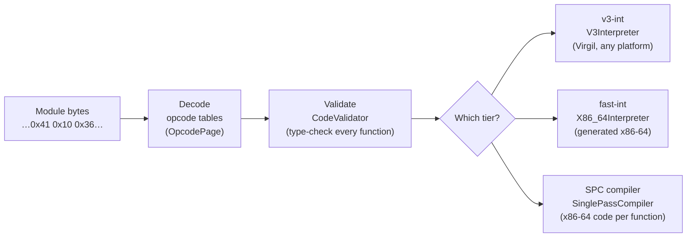
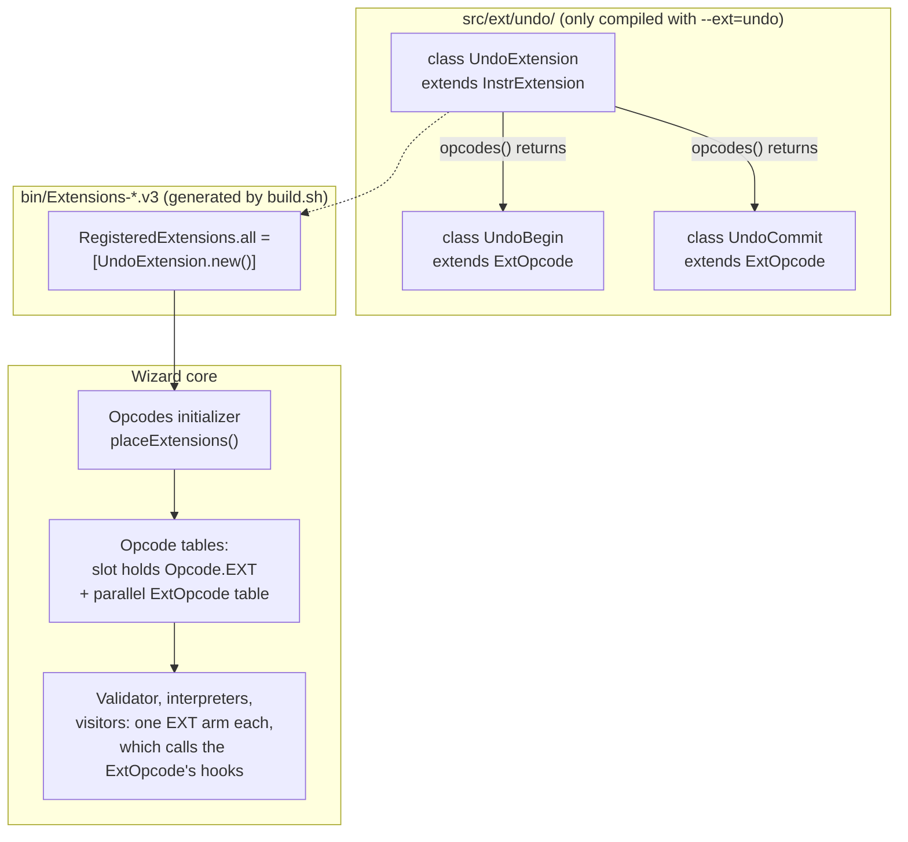
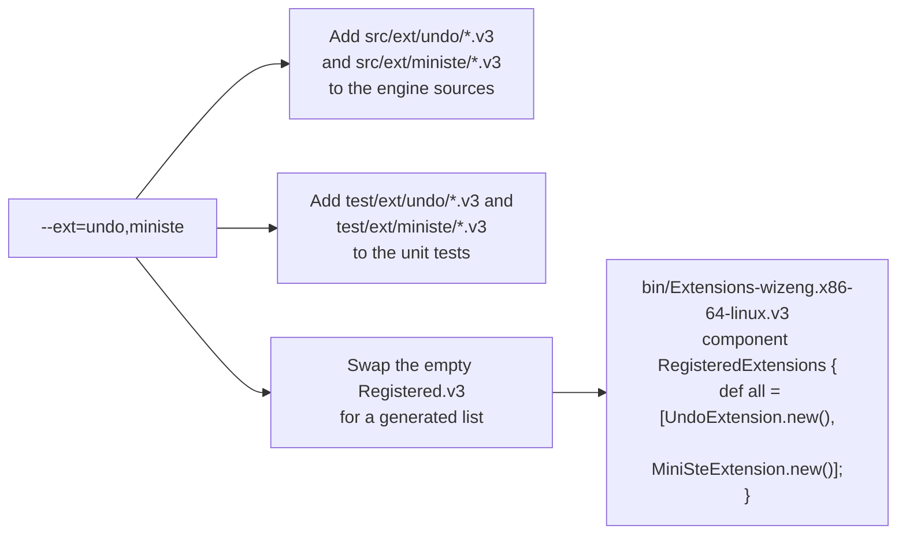
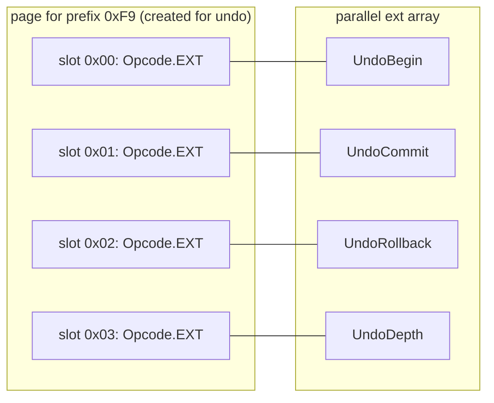
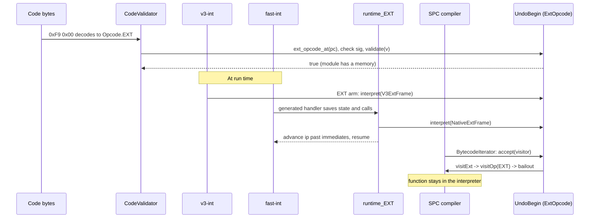
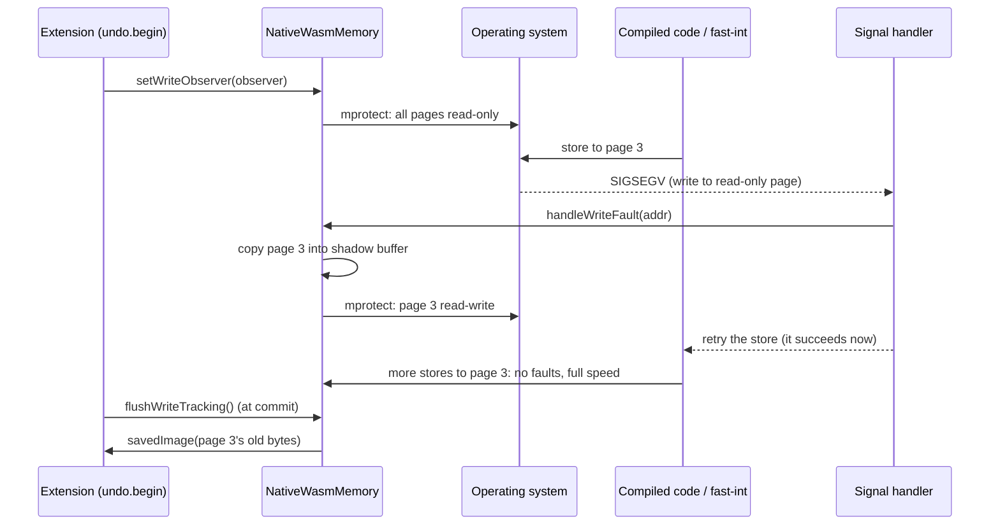
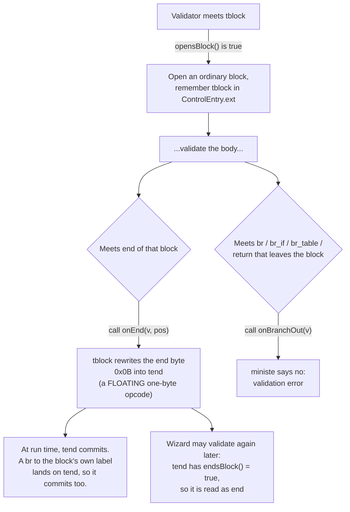
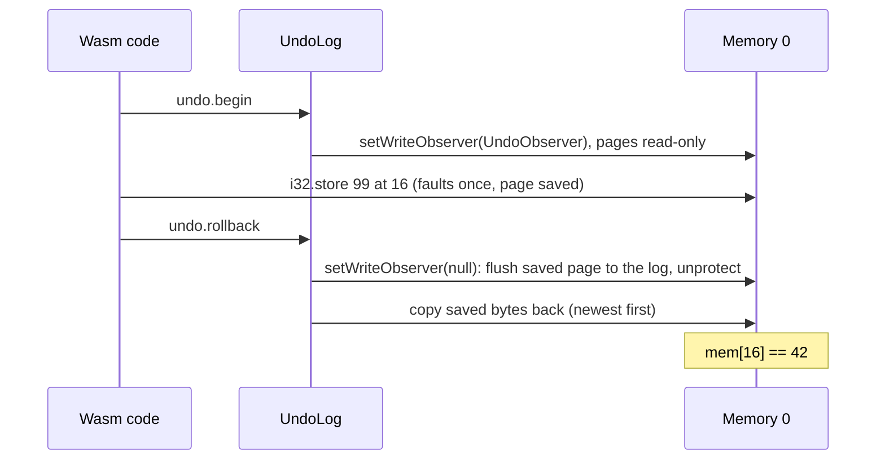
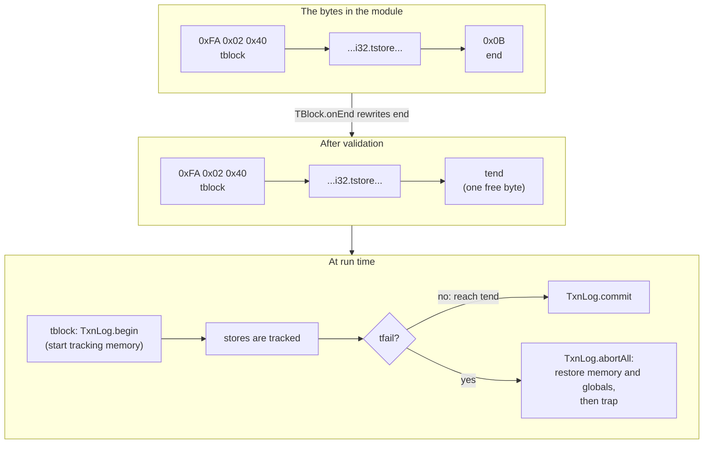
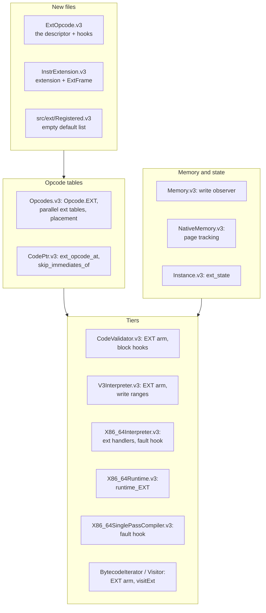

# The Wizard Extension Guide, Version 1

*How to teach an old Wasm engine new instructions, using only the Virgil we have today.*

This is a guide to Version 1 of the instruction set extension framework for the Wizard WebAssembly engine, on branch [`ext-v1`](https://github.com/timdrichards/wizard-engine/tree/ext-v1). It is written for someone who knows computer science but has never opened Wizard, never read the WebAssembly spec for fun, and has only heard the word "transaction" at a bank.

There is a companion guide for [Version 2](https://github.com/timdrichards/wizard-engine/blob/ext-v2/ideas/ExtensionsGuideV2.md), which does the same job with a Virgil language feature that is not merged yet. The [comparison with measurements](https://github.com/timdrichards/wizard-engine/blob/ext-v2/ideas/ExtensionsV1V2.md) and the shorter [design notes](Extensions.md) are there for when you want the numbers or the terse version.

**About the links.** Every link to code is pinned to commit [`11e9758f`](https://github.com/timdrichards/wizard-engine/commit/11e9758fd7cb63d6e1267fdee03d00f69e036a48), the last code commit on `ext-v1`. The line numbers will not drift as the branch moves on. Links to unchanged Wizard code point at the same commit.

---

## Contents

1. [The thirty-second tour](#1-the-thirty-second-tour)
2. [How Wizard runs an instruction today](#2-how-wizard-runs-an-instruction-today)
3. [The problem, and Ben's house rules](#3-the-problem-and-bens-house-rules)
4. [The big idea of Version 1](#4-the-big-idea-of-version-1)
5. [Anatomy of an extension instruction](#5-anatomy-of-an-extension-instruction)
6. [Turning an extension on: the build](#6-turning-an-extension-on-the-build)
7. [Finding a seat: opcode placement](#7-finding-a-seat-opcode-placement)
8. [One instruction, four ways to run it](#8-one-instruction-four-ways-to-run-it)
9. [Watching memory: the write observer and page tracking](#9-watching-memory-the-write-observer-and-page-tracking)
10. [Instructions shaped like blocks](#10-instructions-shaped-like-blocks)
11. [Where an extension keeps its stuff](#11-where-an-extension-keeps-its-stuff)
12. [Extension one: undo](#12-extension-one-undo)
13. [Extension two: ministe](#13-extension-two-ministe)
14. [Everything that changed in Wizard](#14-everything-that-changed-in-wizard)
15. [What changed in Virgil (nothing!)](#15-what-changed-in-virgil-nothing)
16. [Building and testing it yourself](#16-building-and-testing-it-yourself)
17. [How it measures up](#17-how-it-measures-up)
18. [Is it right? A checklist for reviewers](#18-is-it-right-a-checklist-for-reviewers)
19. [Glossary](#19-glossary)

---

## 1. The thirty-second tour

Three ideas, and then we are off.

**WebAssembly (Wasm)** is a portable machine language. A Wasm *module* is a file of functions written as compact bytes. Each instruction starts with an *opcode*, a number that says what to do: `0x6A` means "add two 32-bit integers", `0x36` means "store a 32-bit integer to memory". Some instructions are followed by *immediates*, extra bytes baked into the code such as a memory offset or a global variable's index. Wasm is a *stack machine*: `i32.add` pops two values and pushes their sum. A module has a *linear memory*, one big array of bytes it can load from and store to.

There are more than 256 Wasm instructions, so one byte is not enough. Wasm uses *prefix bytes*: `0xFC`, `0xFD` and friends say "the real opcode follows, as a number". So an opcode is really a pair, a prefix (or none) and a code.

**Wizard** is a Wasm engine, a program that runs Wasm modules, written by Ben Titzer in a language called **Virgil**. Wizard can run code several ways, called *tiers*: a slow, simple interpreter written in Virgil, a fast interpreter written in hand-generated x86-64 machine code, and a compiler that turns Wasm functions into x86-64. More on those in a moment.

**A transaction** is a group of changes that happen all together or not at all. If something goes wrong halfway, every change is undone, and the world looks as if the transaction never started. Eliot Moss's group wants Wasm programs to be able to say "run this block as a transaction". That needs new instructions. And that is where our story begins.

---

## 2. How Wizard runs an instruction today

Before we add anything, here is the road every instruction travels.



**Decoding.** Every opcode Wizard knows is a case of one big Virgil enum, [`Opcode`](https://github.com/timdrichards/wizard-engine/blob/11e9758fd7cb63d6e1267fdee03d00f69e036a48/src/engine/Opcodes.v3#L9), about 590 of them. Each case carries its prefix, code, name (`mnemonic`), the kinds of immediates it has, and its type signature (what it pops and pushes). To turn bytes into an `Opcode`, Wizard looks them up in tables: one table for single-byte opcodes and one [`OpcodePage`](https://github.com/timdrichards/wizard-engine/blob/11e9758fd7cb63d6e1267fdee03d00f69e036a48/src/engine/Opcodes.v3#L736) per prefix byte.

**Validation.** Wasm promises that code is type-safe before it runs. Wizard's [`CodeValidator`](https://github.com/timdrichards/wizard-engine/blob/11e9758fd7cb63d6e1267fdee03d00f69e036a48/src/engine/CodeValidator.v3) walks each function once, tracking the types on the stack and the nesting of blocks, and rejects anything wrong. It is a giant `match` over `Opcode`, one arm per instruction.

**Running.** Wizard has three ways to run validated code:

| Tier | What it is | Where it lives |
|---|---|---|
| **v3-int** | An interpreter written in plain Virgil. Slow and simple; runs anywhere Virgil runs, including the `v3i` target, where Virgil itself is interpreted. Another giant `match` over `Opcode`. | [`V3Interpreter.v3`](https://github.com/timdrichards/wizard-engine/blob/11e9758fd7cb63d6e1267fdee03d00f69e036a48/src/engine/v3/V3Interpreter.v3) |
| **fast-int** | An interpreter whose instruction handlers are x86-64 machine code that Wizard generates when it starts. A *dispatch table* maps each opcode byte to its handler. | [`X86_64Interpreter.v3`](https://github.com/timdrichards/wizard-engine/blob/11e9758fd7cb63d6e1267fdee03d00f69e036a48/src/engine/x86-64/X86_64Interpreter.v3) |
| **SPC** | The single-pass compiler: turns a whole Wasm function into x86-64 code. If it meets something it cannot compile, it *bails out* and the function stays in the interpreter. | [`SinglePassCompiler.v3`](https://github.com/timdrichards/wizard-engine/blob/11e9758fd7cb63d6e1267fdee03d00f69e036a48/src/engine/compiler/SinglePassCompiler.v3) |

Wizard's `--mode` option picks how these combine: `int` (interpreter only), `jit` (compile everything up front, falling back to the interpreter on a bailout), `lazy` and `dyn` (compile as functions get hot). Our tests run every extension instruction in all four.

**Visitors.** Lots of tools inside Wizard walk bytecode: the compiler, monitors that count instructions, the disassembler. They use a [`BytecodeIterator`](https://github.com/timdrichards/wizard-engine/blob/11e9758fd7cb63d6e1267fdee03d00f69e036a48/src/engine/BytecodeIterator.v3), which decodes each instruction and calls a method on a [`BytecodeVisitor`](https://github.com/timdrichards/wizard-engine/blob/11e9758fd7cb63d6e1267fdee03d00f69e036a48/src/util/BytecodeVisitor.v3): `visit_I32_ADD()`, `visit_BLOCK(...)`, and so on, about 590 of them.

Notice the pattern: **every one of these places has a list of every instruction.** Adding a new instruction the old way means editing the enum, the tables, the validator, the interpreter, the fast interpreter, the compiler and the visitor. That is the problem.

---

## 3. The problem, and Ben's house rules

We want an extension, say transactions, to live in its own folder, switched on when you build Wizard, without sprinkling changes through all those giant `match` statements. In September 2026, Ben Titzer (who owns Wizard and Virgil) set out some house rules for doing that:

1. **Don't add fields to classes from outside the class.** Initialization order gets murky. Weak maps would be the right tool, when Virgil has them.
2. **No per-case methods on enums, for now.** (Version 2 breaks this rule on purpose, to see what we would gain.)
3. **Extensible enums and top-level methods wait** for a stable Virgil language revision.
4. **Have a configuration phase at build time** where extensions register their opcodes, validation, compiler support and so on.
5. **Two kinds of opcode claims.** Some extensions need *fixed* encodings, because real Wasm files use them (transactions). Others can take *any leftover* opcode, because only the engine ever writes them.
6. **Rely on opcode tables, not the `Opcode` enum**, until the enum can be extended.
7. **Visitors** are an open problem.

Version 1 follows every one of these rules.

---

## 4. The big idea of Version 1

Here it is in one picture:



In words:

- **Each new instruction is a small class**, a subclass of [`ExtOpcode`](https://github.com/timdrichards/wizard-engine/blob/11e9758fd7cb63d6e1267fdee03d00f69e036a48/src/engine/ExtOpcode.v3#L14). It holds the instruction's encoding and overrides *hooks*: how to validate it, how to run it, and so on. Encoding, rules and behavior sit together in one place.
- **An extension is a list of those classes**, returned by a subclass of [`InstrExtension`](https://github.com/timdrichards/wizard-engine/blob/11e9758fd7cb63d6e1267fdee03d00f69e036a48/src/engine/InstrExtension.v3#L7).
- **The build decides which extensions exist.** `build.sh --ext=undo` compiles `src/ext/undo/` and generates a one-line list naming `UndoExtension`.
- **The core `Opcode` enum gains exactly one case, `EXT`.** It means "this slot belongs to an extension; look in the side table". Every giant `match` gets one new arm for `EXT`, which looks up the `ExtOpcode` and calls its hook.

Since Virgil has no per-case methods (rule 2), "a class per instruction" is the closest thing to "a case per instruction" we can write today. Since the enum can't grow (rule 3), one `EXT` case stands in for all of them (rule 6).

---

## 5. Anatomy of an extension instruction

Here is [`ExtOpcode`](https://github.com/timdrichards/wizard-engine/blob/11e9758fd7cb63d6e1267fdee03d00f69e036a48/src/engine/ExtOpcode.v3#L14), lightly trimmed:

```
class ExtOpcode(prefix: u8, code: u16, mnemonic: string, imms: Array<ImmKind>,
                sig: SigDecl, claim: OpcodeClaim) {
    var owner: InstrExtension;     // set when placed
    var placed_prefix: u8;         // where it actually ended up
    var placed_code: u16;

    def validate(v: CodeValidator) -> bool { return true; }
    def interpret(f: ExtFrame) -> TrapReason { return TrapReason.UNIMPLEMENTED; }
    def accept(v: BytecodeVisitor) { v.visitExt(this); }
    def opensBlock() -> bool { return false; }
    def onEnd(v: CodeValidator, pos: int) { }
    def endsBlock() -> bool { return false; }
    def onBranchOut(v: CodeValidator) -> bool { return true; }
}
```

The constructor arguments are the same facts every core `Opcode` carries, plus a **claim** ([`OpcodeClaim`](https://github.com/timdrichards/wizard-engine/blob/11e9758fd7cb63d6e1267fdee03d00f69e036a48/src/engine/ExtOpcode.v3#L5)): `FIXED` means "put me at exactly this prefix and code", `FLOATING` means "any free one-byte slot will do; I'm internal".

The hooks, in plain words:

| Hook | Who calls it | What it is for |
|---|---|---|
| [`validate`](https://github.com/timdrichards/wizard-engine/blob/11e9758fd7cb63d6e1267fdee03d00f69e036a48/src/engine/ExtOpcode.v3#L23) | the validator | Extra checks beyond the type signature, such as "only inside a transaction". If `sig` is null, this hook does the stack typing itself. |
| [`interpret`](https://github.com/timdrichards/wizard-engine/blob/11e9758fd7cb63d6e1267fdee03d00f69e036a48/src/engine/ExtOpcode.v3#L28) | both interpreters | What the instruction actually does. Gets an `ExtFrame` to pop, push and read immediates. Returns `NONE` or a reason to trap. |
| [`accept`](https://github.com/timdrichards/wizard-engine/blob/11e9758fd7cb63d6e1267fdee03d00f69e036a48/src/engine/ExtOpcode.v3#L33) | bytecode iterators | Shows the instruction to a visitor. Default: `v.visitExt(this)`. |
| [`opensBlock`](https://github.com/timdrichards/wizard-engine/blob/11e9758fd7cb63d6e1267fdee03d00f69e036a48/src/engine/ExtOpcode.v3#L39), [`onEnd`](https://github.com/timdrichards/wizard-engine/blob/11e9758fd7cb63d6e1267fdee03d00f69e036a48/src/engine/ExtOpcode.v3#L45), [`endsBlock`](https://github.com/timdrichards/wizard-engine/blob/11e9758fd7cb63d6e1267fdee03d00f69e036a48/src/engine/ExtOpcode.v3#L48), [`onBranchOut`](https://github.com/timdrichards/wizard-engine/blob/11e9758fd7cb63d6e1267fdee03d00f69e036a48/src/engine/ExtOpcode.v3#L53) | the validator | For instructions shaped like a block (`tblock ... end`). See [chapter 10](#10-instructions-shaped-like-blocks). |

An instruction only overrides what it needs. Here is `undo.begin`, the whole thing:

```
class UndoBegin extends UndoOp {
    new() super(0x00, "undo.begin", SigCache.v_v) { }
    def interpret(f: ExtFrame) -> TrapReason { return UndoLogs.of(f.instance()).begin(); }
}
```

Its parent, [`UndoOp`](https://github.com/timdrichards/wizard-engine/blob/11e9758fd7cb63d6e1267fdee03d00f69e036a48/src/ext/undo/Undo.v3#L26), fills in the shared prefix `0xF9`, the `FIXED` claim and a shared `validate` rule. That is ordinary inheritance doing what it does best.

**The `ExtFrame`.** The `interpret` hook needs to touch the running program: pop arguments, push results, read immediates, and find the current module instance. [`ExtFrame`](https://github.com/timdrichards/wizard-engine/blob/11e9758fd7cb63d6e1267fdee03d00f69e036a48/src/engine/InstrExtension.v3#L16) is that window:

```
class ExtFrame {
    def imm = CodePtr.new(null);    // positioned at the instruction's immediates
    def instance() -> Instance;
    def pop(t: ValueType) -> Value;
    def push(v: Value);
    def popi() -> i32;  def pushi(v: i32);
}
```

Each tier supplies its own: [`V3ExtFrame`](https://github.com/timdrichards/wizard-engine/blob/11e9758fd7cb63d6e1267fdee03d00f69e036a48/src/engine/v3/V3Interpreter.v3#L2258) for the Virgil interpreter, [`NativeExtFrame`](https://github.com/timdrichards/wizard-engine/blob/11e9758fd7cb63d6e1267fdee03d00f69e036a48/src/engine/x86-64/X86_64Runtime.v3#L276) for the fast one. `pop` takes a type because the fast interpreter's value stack needs to know what it is popping.

**A small Virgil wrinkle.** Virgil has no `super.method()` call. If `TFail` wants "the shared transaction check, plus one more thing", it can't call its parent's `validate`. So shared checks become named helpers (`inTransaction(v)`) that subclasses call. Mildly annoying, perfectly workable.

---

## 6. Turning an extension on: the build

An extension lives in `src/ext/<name>/` and contains:

- one or more `.v3` files with its `InstrExtension` and `ExtOpcode` classes;
- an `extension.txt` holding the Virgil expression that creates it. For undo, the whole file is: `UndoExtension.new()` ([source](https://github.com/timdrichards/wizard-engine/blob/11e9758fd7cb63d6e1267fdee03d00f69e036a48/src/ext/undo/extension.txt)).

Its tests live in `test/ext/<name>/`.

You build with the new flag ([`build.sh` line 119](https://github.com/timdrichards/wizard-engine/blob/11e9758fd7cb63d6e1267fdee03d00f69e036a48/build.sh#L119)):

```
./build.sh --ext=undo,ministe wizeng x86-64-linux
```

and `build.sh` does three things ([lines 151 to 166](https://github.com/timdrichards/wizard-engine/blob/11e9758fd7cb63d6e1267fdee03d00f69e036a48/build.sh#L151-L166) and [228 to 244](https://github.com/timdrichards/wizard-engine/blob/11e9758fd7cb63d6e1267fdee03d00f69e036a48/build.sh#L228-L244)):



Without `--ext`, the build compiles [`src/ext/Registered.v3`](https://github.com/timdrichards/wizard-engine/blob/11e9758fd7cb63d6e1267fdee03d00f69e036a48/src/ext/Registered.v3#L7), whose list is empty.

Why generate a file instead of checking in a list? Because a checked-in list that names `UndoExtension` would fail to compile in a build *without* `--ext=undo`: the class wouldn't exist. So the list has to follow the flag.

Virgil compiles the whole program at once, and runs component initializers *at compile time*. So when the list is empty, every bit of extension code is unreachable and is thrown away. An unextended Wizard carries almost nothing extra (we measured: [chapter 17](#17-how-it-measures-up)).

---

## 7. Finding a seat: opcode placement

Every extension instruction needs an encoding, a seat in the opcode tables. This happens in the [`Opcodes`](https://github.com/timdrichards/wizard-engine/blob/11e9758fd7cb63d6e1267fdee03d00f69e036a48/src/engine/Opcodes.v3#L830) component initializer, which ends by calling [`placeExtensions(RegisteredExtensions.all)`](https://github.com/timdrichards/wizard-engine/blob/11e9758fd7cb63d6e1267fdee03d00f69e036a48/src/engine/Opcodes.v3#L870). Since component initializers run inside the compiler, **placement happens at build time**, and the finished tables are baked into the binary. That is Ben's "configuration phase" (rule 4), for free.

[`placeExtensions`](https://github.com/timdrichards/wizard-engine/blob/11e9758fd7cb63d6e1267fdee03d00f69e036a48/src/engine/Opcodes.v3#L875) works in two rounds:

1. **Fixed claims first** ([`placeFixed`](https://github.com/timdrichards/wizard-engine/blob/11e9758fd7cb63d6e1267fdee03d00f69e036a48/src/engine/Opcodes.v3#L897)). Each goes at exactly its prefix and code. If its prefix byte is not a prefix yet, and nothing else uses that byte, the byte *becomes* a prefix, with a new page just for this extension ([`addExtPage`](https://github.com/timdrichards/wizard-engine/blob/11e9758fd7cb63d6e1267fdee03d00f69e036a48/src/engine/Opcodes.v3#L947)). That is how undo gets `0xF9` and ministe gets `0xFA`.
2. **Floating claims second** ([`placeFloating`](https://github.com/timdrichards/wizard-engine/blob/11e9758fd7cb63d6e1267fdee03d00f69e036a48/src/engine/Opcodes.v3#L923)). Each takes the first one-byte slot that nobody uses ([`slotUser`](https://github.com/timdrichards/wizard-engine/blob/11e9758fd7cb63d6e1267fdee03d00f69e036a48/src/engine/Opcodes.v3#L933) says who is sitting there, if anyone).

If two claims want the same seat, **the build stops** with an error naming both. (Before this change, `OpcodePage.put` would silently let the later one win. Eek.)

What actually goes in the table? A slot can only hold an `Opcode`, and we can't add cases to the enum. So the slot holds the single placeholder [`Opcode.EXT`](https://github.com/timdrichards/wizard-engine/blob/11e9758fd7cb63d6e1267fdee03d00f69e036a48/src/engine/Opcodes.v3#L622), and a **parallel array** right next to it holds the real `ExtOpcode`: [`OpcodePage.ext`](https://github.com/timdrichards/wizard-engine/blob/11e9758fd7cb63d6e1267fdee03d00f69e036a48/src/engine/Opcodes.v3#L740) for prefixed pages and [`Opcodes.ext_no_prefix`](https://github.com/timdrichards/wizard-engine/blob/11e9758fd7cb63d6e1267fdee03d00f69e036a48/src/engine/Opcodes.v3#L846) for single bytes.



To go from bytes to the real instruction, code calls [`CodePtr.ext_opcode_at(pc)`](https://github.com/timdrichards/wizard-engine/blob/11e9758fd7cb63d6e1267fdee03d00f69e036a48/src/engine/CodePtr.v3#L17), which re-reads the bytes at `pc` and asks [`Opcodes.findExt`](https://github.com/timdrichards/wizard-engine/blob/11e9758fd7cb63d6e1267fdee03d00f69e036a48/src/engine/Opcodes.v3#L956). It is a two-step lookup: the table says "it's an extension", the side table says which one.

Every placed instruction is also kept in [`Opcodes.ext_opcodes`](https://github.com/timdrichards/wizard-engine/blob/11e9758fd7cb63d6e1267fdee03d00f69e036a48/src/engine/Opcodes.v3#L848), for the fast interpreter, which needs one handler per instruction (next chapter).

---

## 8. One instruction, four ways to run it

Let's follow `undo.begin` (bytes `0xF9 0x00`) through every part of Wizard.



**The validator** ([`EXT` arm, line 1388](https://github.com/timdrichards/wizard-engine/blob/11e9758fd7cb63d6e1267fdee03d00f69e036a48/src/engine/CodeValidator.v3#L1388)):

1. Find the `ExtOpcode` at this position. None? It's an invalid opcode, just as before.
2. If it has a signature, check it like any core instruction (pop the inputs, push the outputs).
3. If it opens a block, open one (chapter 10).
4. Call its `validate` hook.
5. Skip past its immediates, whatever the hook read. That way a buggy hook can't leave the validator lost in the middle of an instruction.

**v3-int** ([`EXT` arm, line 1402](https://github.com/timdrichards/wizard-engine/blob/11e9758fd7cb63d6e1267fdee03d00f69e036a48/src/engine/v3/V3Interpreter.v3#L1402)): find the `ExtOpcode`, point the frame's `imm` reader at the immediates, call `interpret`, skip the immediates, and trap if asked to. The `V3ExtFrame` is created once, the first time any extension instruction runs ([line 7](https://github.com/timdrichards/wizard-engine/blob/11e9758fd7cb63d6e1267fdee03d00f69e036a48/src/engine/v3/V3Interpreter.v3#L7)).

**fast-int.** This one is fun. The fast interpreter is a table of machine-code handlers, one per opcode. When Wizard starts, it generates them. [`genExtHandlers`](https://github.com/timdrichards/wizard-engine/blob/11e9758fd7cb63d6e1267fdee03d00f69e036a48/src/engine/x86-64/X86_64Interpreter.v3#L4102) (called at [line 946](https://github.com/timdrichards/wizard-engine/blob/11e9758fd7cb63d6e1267fdee03d00f69e036a48/src/engine/x86-64/X86_64Interpreter.v3#L946)) makes one tiny handler for each placed extension instruction and writes it into the dispatch table at that instruction's encoding ([`patchDispatchTableAt`](https://github.com/timdrichards/wizard-engine/blob/11e9758fd7cb63d6e1267fdee03d00f69e036a48/src/engine/x86-64/X86_64Interpreter.v3#L4044)). Each handler does the same dull, reliable thing: save the interpreter's registers, call [`runtime_EXT`](https://github.com/timdrichards/wizard-engine/blob/11e9758fd7cb63d6e1267fdee03d00f69e036a48/src/engine/x86-64/X86_64Runtime.v3#L72) (ordinary Virgil code), restore the registers, and go to the next instruction.

`runtime_EXT` finds the `ExtOpcode`, builds a `NativeExtFrame`, calls `interpret`, and then does one sneaky thing: the handler will resume just after the opcode bytes, so if the instruction has immediates, `runtime_EXT` nudges the saved instruction pointer past them. With no extensions, no handlers are generated at all.

**SPC, the compiler.** The compiler walks bytecode with a visitor. An extension instruction reaches it through the `BytecodeIterator`'s [`EXT` arm](https://github.com/timdrichards/wizard-engine/blob/11e9758fd7cb63d6e1267fdee03d00f69e036a48/src/engine/BytecodeIterator.v3#L204), which calls `accept`, which calls [`visitExt`](https://github.com/timdrichards/wizard-engine/blob/11e9758fd7cb63d6e1267fdee03d00f69e036a48/src/util/BytecodeVisitor.v3#L21), whose default calls `visitOp(Opcode.EXT)`, and the compiler's [`visitOp`](https://github.com/timdrichards/wizard-engine/blob/11e9758fd7cb63d6e1267fdee03d00f69e036a48/src/engine/compiler/SinglePassCompiler.v3#L389) bails out with "unsupported opcode". That's the existing behavior for anything the compiler doesn't know, and it's exactly what we want: **a function that uses an extension instruction stays in the interpreter, and every other function still gets compiled.** No change to the compiler was needed for this.

So an extension that writes only `validate` and `interpret` **works correctly in every tier**. Making it *fast* (a hand-written fast-int handler, or compiler support) is a later, optional step. We didn't build it; see [chapter 18](#18-is-it-right-a-checklist-for-reviewers).

**Visitors in general.** `visitExt(op)` is one new method on `BytecodeVisitor`. Three kinds of visitors cope three ways:

- Most don't care what the instruction *is*, only what it does to the stack. They read `op.sig`, or just get the default `visitOp`.
- A visitor that cares about a particular instruction overrides `visitExt` and checks which `op` it got.
- An extension that needs to change how some visitor sees it overrides `accept` and type-tests the visitor (double dispatch, from the extension's side).

That is our answer to rule 7, "visitors are an open problem". It's an answer, not *the* answer.

Two core loops that walk every opcode now skip the placeholder: [`OpcodeMap`](https://github.com/timdrichards/wizard-engine/blob/11e9758fd7cb63d6e1267fdee03d00f69e036a48/src/util/OpcodeMap.v3#L96) and the [Whamm monitor](https://github.com/timdrichards/wizard-engine/blob/11e9758fd7cb63d6e1267fdee03d00f69e036a48/src/monitors/WhammMonitor.v3#L53).

---

## 9. Watching memory: the write observer and page tracking

Here's the catch with undo and transactions. To undo a write, you must know about it *before* it happens, so you can save the old bytes. Hooks on our new instructions don't help: the writes we care about are made by plain old `i32.store`, by `memory.fill`, by a function we called, by the compiled code. We need to see **every write to memory**, from every tier, without slowing down programs that don't care.

We used two tricks: one for code written in Virgil, one for machine code.

### Trick one: a write observer, for Virgil code

[`Memory`](https://github.com/timdrichards/wizard-engine/blob/11e9758fd7cb63d6e1267fdee03d00f69e036a48/src/engine/Memory.v3#L14) gains one field, `writeObserver`, and two new methods, [`write_range_oil_64`](https://github.com/timdrichards/wizard-engine/blob/11e9758fd7cb63d6e1267fdee03d00f69e036a48/src/engine/Memory.v3#L88) and [`write_range_ol_64`](https://github.com/timdrichards/wizard-engine/blob/11e9758fd7cb63d6e1267fdee03d00f69e036a48/src/engine/Memory.v3#L94). They return the same byte range as the existing read versions, but first say "heads up, these bytes are about to change" to the observer, a [`MemoryWriteObserver`](https://github.com/timdrichards/wizard-engine/blob/11e9758fd7cb63d6e1267fdee03d00f69e036a48/src/engine/Memory.v3#L236).

Every Virgil path that writes memory now uses them:

- the v3 interpreter's stores, through [`decodeMemArgAndGetMemoryRangeForWrite`](https://github.com/timdrichards/wizard-engine/blob/11e9758fd7cb63d6e1267fdee03d00f69e036a48/src/engine/v3/V3Interpreter.v3#L1431), which covers plain stores, lane stores and the atomics;
- `Memory.fill`, `copyM`, `copyIn` and `readIn`, which cover `memory.fill`, `memory.copy`, `memory.init` and host reads into memory.

With no observer installed, the cost is one null check per write.

### Trick two: page protection, for machine code

The fast interpreter and compiled code store straight into memory with a single machine instruction. There is no Virgil method to hook. Changing every store in the code generator would be invasive and would slow down everyone.

So we borrowed a trick from operating systems and garbage collectors: **make the memory read-only and let the hardware tell us.**



Step by step, in [`NativeMemory.v3`](https://github.com/timdrichards/wizard-engine/blob/11e9758fd7cb63d6e1267fdee03d00f69e036a48/src/engine/native/NativeMemory.v3#L79):

1. When an observer is installed, [`startTracking`](https://github.com/timdrichards/wizard-engine/blob/11e9758fd7cb63d6e1267fdee03d00f69e036a48/src/engine/native/NativeMemory.v3#L127) allocates a *shadow buffer* the size of the memory and marks every 4 KiB page read-only.
2. The **first** store to a page traps into the operating system, which sends Wizard a `SIGSEGV` signal. Both of Wizard's signal handlers, the [fast interpreter's](https://github.com/timdrichards/wizard-engine/blob/11e9758fd7cb63d6e1267fdee03d00f69e036a48/src/engine/x86-64/X86_64Interpreter.v3#L147) and the [compiler's](https://github.com/timdrichards/wizard-engine/blob/11e9758fd7cb63d6e1267fdee03d00f69e036a48/src/engine/x86-64/X86_64SinglePassCompiler.v3#L1295), now ask [`NativeMemoryTracking.handleWriteFault`](https://github.com/timdrichards/wizard-engine/blob/11e9758fd7cb63d6e1267fdee03d00f69e036a48/src/engine/native/NativeMemory.v3#L182) first: "is this one of yours?"
3. If it is, [`handleWriteFault`](https://github.com/timdrichards/wizard-engine/blob/11e9758fd7cb63d6e1267fdee03d00f69e036a48/src/engine/native/NativeMemory.v3#L115) copies the page into the shadow buffer, makes the page writable and says "retry". The store runs again and succeeds. It allocates nothing, because allocating inside a signal handler is asking for trouble.
4. Every later store to that page runs at full speed. No more faults.
5. Later, outside the signal handler, [`flushWriteTracking`](https://github.com/timdrichards/wizard-engine/blob/11e9758fd7cb63d6e1267fdee03d00f69e036a48/src/engine/native/NativeMemory.v3#L87) hands each saved page to the observer as `savedImage(pos, oldBytes)`. [`restartWriteTracking`](https://github.com/timdrichards/wizard-engine/blob/11e9758fd7cb63d6e1267fdee03d00f69e036a48/src/engine/native/NativeMemory.v3#L96) makes every page read-only again, so a nested checkpoint sees its own first writes.

Writes through `write_range_*` on a native memory save and unlock their pages directly ([`openPages`](https://github.com/timdrichards/wizard-engine/blob/11e9758fd7cb63d6e1267fdee03d00f69e036a48/src/engine/native/NativeMemory.v3#L145)), so Virgil code never faults.

The upshot: **the v3 interpreter reports every write, byte for byte, and native code reports the first write to each page, page by page.** Either way the observer gets "here are the old bytes at this position" and can undo by copying them back. No generated code changed, and with no observer installed, nothing costs anything.

This machinery is the same in Version 1 and Version 2.

---

## 10. Instructions shaped like blocks

Undo uses plain instructions: `undo.begin`, then later `undo.commit`. Real transactions look like Wasm blocks:

```
tblock
  ...stores...
end          ;; the transaction commits here
```

This is harder than it looks, for two reasons. First, the interpreter runs `end` without knowing which block it closes. A plain `end` can't "commit". Second, a branch (`br`) can jump out of the middle of a block and skip its `end` entirely. What then?

Our answer has four parts, all in the validator:



1. **Opening.** If an instruction's [`opensBlock()`](https://github.com/timdrichards/wizard-engine/blob/11e9758fd7cb63d6e1267fdee03d00f69e036a48/src/engine/ExtOpcode.v3#L39) is true, its first immediate is a block type, and the validator opens a normal block for it, remembering the instruction in that block's control entry, [`ControlEntry.ext`](https://github.com/timdrichards/wizard-engine/blob/11e9758fd7cb63d6e1267fdee03d00f69e036a48/src/engine/CodeValidator.v3#L1882).
2. **Code at the end.** When the validator reaches the matching `end`, it calls [`onEnd`](https://github.com/timdrichards/wizard-engine/blob/11e9758fd7cb63d6e1267fdee03d00f69e036a48/src/engine/CodeValidator.v3#L396). The instruction may **rewrite the `end` byte** into a one-byte extension opcode with [`rewriteOpcode`](https://github.com/timdrichards/wizard-engine/blob/11e9758fd7cb63d6e1267fdee03d00f69e036a48/src/engine/CodeValidator.v3#L1818). Ministe rewrites it to `tend`, which commits. Wizard already rewrites bytecode in place for probes, so this isn't as wild as it sounds. And a branch to the block's own label lands on that same byte, so it commits too. Neat.
3. **Validating twice.** Wizard sometimes validates a function again (for example after instrumenting it). The second time, the byte is `tend`, not `end`. So `tend` declares [`endsBlock()`](https://github.com/timdrichards/wizard-engine/blob/11e9758fd7cb63d6e1267fdee03d00f69e036a48/src/engine/ExtOpcode.v3#L48) and the validator [reads it as `end`](https://github.com/timdrichards/wizard-engine/blob/11e9758fd7cb63d6e1267fdee03d00f69e036a48/src/engine/CodeValidator.v3#L248). (We found this one the hard way: the first version broke on revalidation.)
4. **Leaving early.** `br`, `br_if`, `br_table` and `return` call [`checkBranchOut`](https://github.com/timdrichards/wizard-engine/blob/11e9758fd7cb63d6e1267fdee03d00f69e036a48/src/engine/CodeValidator.v3#L1802), which asks every extension block being left via [`onBranchOut`](https://github.com/timdrichards/wizard-engine/blob/11e9758fd7cb63d6e1267fdee03d00f69e036a48/src/engine/ExtOpcode.v3#L53). Ministe forbids it, so the module is rejected.

One more helper: [`enclosingExt(owner)`](https://github.com/timdrichards/wizard-engine/blob/11e9758fd7cb63d6e1267fdee03d00f69e036a48/src/engine/CodeValidator.v3#L1810) finds the innermost block opened by an instruction of a given extension. Ministe uses it to enforce "this instruction must be inside a `tblock`".

Eliot's transactional Wizard also rewrites the ends of transaction blocks in the validator. We arrived at the same place independently-ish, which is reassuring.

---

## 11. Where an extension keeps its stuff

An undo log has to live somewhere, one per running module instance. Ben's rule 1 says we can't bolt a field onto `Instance` from the extension's file. So `Instance` gets **one** field, declared in the core: [`ext_state`](https://github.com/timdrichards/wizard-engine/blob/11e9758fd7cb63d6e1267fdee03d00f69e036a48/src/engine/Instance.v3#L83), the head of a linked chain of [`InstanceExtState`](https://github.com/timdrichards/wizard-engine/blob/11e9758fd7cb63d6e1267fdee03d00f69e036a48/src/engine/Instance.v3#L178) objects. Each extension subclasses `InstanceExtState` and finds its own link by type, creating it on first use:

```
component UndoLogs {
    def of(instance: Instance) -> UndoLog {
        for (s = instance.ext_state; s != null; s = s.next) {
            if (UndoLog.?(s)) return UndoLog.!(s);
        }
        ...create one and push it on the chain...
    }
}
```

`UndoLog.?(s)` is Virgil for "is `s` an `UndoLog`?" and `UndoLog.!(s)` is the cast. With one or two extensions the chain is one or two links long. When Virgil gets weak maps, this becomes a weak map from `Instance` to `UndoLog`, and the field goes away.

---

## 12. Extension one: undo

Undo is the proof of concept: a deliberately small extension that exercises the framework end to end. It lives in [`src/ext/undo/Undo.v3`](https://github.com/timdrichards/wizard-engine/blob/11e9758fd7cb63d6e1267fdee03d00f69e036a48/src/ext/undo/Undo.v3) (138 lines) and gives Wasm code checkpoints on memory 0:

| Instruction | Bytes | Stack | What it does |
|---|---|---|---|
| `undo.begin` | `0xF9 0x00` | `[] -> []` | open a checkpoint |
| `undo.commit` | `0xF9 0x01` | `[] -> []` | keep the writes since the innermost checkpoint, and close it |
| `undo.rollback` | `0xF9 0x02` | `[] -> []` | put back every byte written since the innermost checkpoint, and close it |
| `undo.depth` | `0xF9 0x03` | `[] -> [i32]` | how many checkpoints are open |

Committing an inner checkpoint folds its writes into the outer one, so rolling back the outer one undoes them too. `commit` or `rollback` with nothing open traps. Since they all act on memory 0, `validate` rejects them in a module with no memory.

A tiny program, in Wasm text with our new instructions:

```
(memory 1)
(func
  (i32.store (i32.const 16) (i32.const 42))  ;; mem[16] = 42
  undo.begin
    (i32.store (i32.const 16) (i32.const 99))  ;; mem[16] = 99
    undo.rollback                              ;; mem[16] is 42 again
)
```

What happens inside, in the fast interpreter:



The parts, with links:

- [`UndoExtension`](https://github.com/timdrichards/wizard-engine/blob/11e9758fd7cb63d6e1267fdee03d00f69e036a48/src/ext/undo/Undo.v3#L18) lists the four instructions.
- [`UndoOp`](https://github.com/timdrichards/wizard-engine/blob/11e9758fd7cb63d6e1267fdee03d00f69e036a48/src/ext/undo/Undo.v3#L26) holds the shared prefix and the shared [`validate`](https://github.com/timdrichards/wizard-engine/blob/11e9758fd7cb63d6e1267fdee03d00f69e036a48/src/ext/undo/Undo.v3#L30) rule.
- [`UndoBegin`](https://github.com/timdrichards/wizard-engine/blob/11e9758fd7cb63d6e1267fdee03d00f69e036a48/src/ext/undo/Undo.v3#L36) and friends are three lines each.
- [`UndoLog`](https://github.com/timdrichards/wizard-engine/blob/11e9758fd7cb63d6e1267fdee03d00f69e036a48/src/ext/undo/Undo.v3#L60) keeps a list of (position, old bytes) pairs and a stack of `marks`, where each open checkpoint starts in the list. [`begin`](https://github.com/timdrichards/wizard-engine/blob/11e9758fd7cb63d6e1267fdee03d00f69e036a48/src/ext/undo/Undo.v3#L66) installs the observer (or restarts tracking, if nested) and pushes a mark. [`commit`](https://github.com/timdrichards/wizard-engine/blob/11e9758fd7cb63d6e1267fdee03d00f69e036a48/src/ext/undo/Undo.v3#L73) pops the mark. [`rollback`](https://github.com/timdrichards/wizard-engine/blob/11e9758fd7cb63d6e1267fdee03d00f69e036a48/src/ext/undo/Undo.v3#L80) stops tracking, copies old bytes back newest first (so the *oldest* saved copy of each byte wins), and trims the list.
- [`UndoObserver`](https://github.com/timdrichards/wizard-engine/blob/11e9758fd7cb63d6e1267fdee03d00f69e036a48/src/ext/undo/Undo.v3#L118) is the bridge from memory to log: `beforeWrite` saves bytes (v3-int), `savedImage` saves pages (native).
- [`UndoLogs.of`](https://github.com/timdrichards/wizard-engine/blob/11e9758fd7cb63d6e1267fdee03d00f69e036a48/src/ext/undo/Undo.v3#L129) finds the log on the instance chain.

**Tests** ([`test/ext/undo/UndoTest.v3`](https://github.com/timdrichards/wizard-engine/blob/11e9758fd7cb63d6e1267fdee03d00f69e036a48/test/ext/undo/UndoTest.v3)): depth counting, rollback and commit of a store, nested checkpoints both ways, unaligned mixed-width stores, `memory.fill` and `memory.copy`, commit and rollback with nothing open, stores made by a called (and compiled) function, and stores on two different pages. Plus a validation test for the no-memory rule. With rollback switched off, exactly the rollback tests fail, which tells us the tests test what they say.

**Why not `undo.block ... end`?** We tried that first. It needed "run code at a particular `end`" and "what about branches out", which are exactly the hard questions of chapter 10. So undo stayed simple, and those questions got their own extension.

---

## 13. Extension two: ministe

Ministe is a single-threaded mini version of the Wasm Simple Transactions proposal (STE), using STE's real encodings on prefix `0xFA`. It's in [`src/ext/ministe/MiniSte.v3`](https://github.com/timdrichards/wizard-engine/blob/11e9758fd7cb63d6e1267fdee03d00f69e036a48/src/ext/ministe/MiniSte.v3) (225 lines).

| Instruction | Bytes | Stack | What it does |
|---|---|---|---|
| `tblock <type> ... end` | `0xFA 0x02` | like `block` | run the body as a transaction, which commits at its `end` |
| `tfail` | `0xFA 0x0F` | `[i32] -> []` | roll back every open transaction, then trap |
| `tglobal.get <g>` | `0xFA 0x23` | `[] -> [t]` | read a global |
| `tglobal.set <g>` | `0xFA 0x24` | `[t] -> []` | write a global; undone if the transaction fails |
| `i32.tload <memarg>` | `0xFA 0x28` | `[i32] -> [i32]` | load from memory 0 |
| `i32.tstore <memarg>` | `0xFA 0x36` | `[i32 i32] -> []` | store to memory 0 |
| `tend` | any free byte | `[] -> []` | internal: what each `tblock`'s `end` becomes; commits |

Everything but `tblock` must appear inside a `tblock`. Left out of the subset: `tblock`'s `else` clause, `ttry` (catching a failure), and branches or returns out of a `tblock`, which are rejected. With no `ttry`, nothing can catch a failure, so `tfail` rolls back *everything* and traps.

Ministe exists to push on the framework where undo doesn't:

| Needs | Where |
|---|---|
| immediates (block type, global index, memory argument) | `ExtFrame.imm`; `v.parser` in `validate` |
| a block-shaped instruction | [`TBlock.opensBlock`](https://github.com/timdrichards/wizard-engine/blob/11e9758fd7cb63d6e1267fdee03d00f69e036a48/src/ext/ministe/MiniSte.v3#L47) |
| code at the block's end | [`TBlock.onEnd`](https://github.com/timdrichards/wizard-engine/blob/11e9758fd7cb63d6e1267fdee03d00f69e036a48/src/ext/ministe/MiniSte.v3#L50) rewrites `end` to `tend` |
| a FLOATING one-byte opcode | [`TEnd`](https://github.com/timdrichards/wizard-engine/blob/11e9758fd7cb63d6e1267fdee03d00f69e036a48/src/ext/ministe/MiniSte.v3#L63) |
| nesting rules | [`TxnOp.inTransaction`](https://github.com/timdrichards/wizard-engine/blob/11e9758fd7cb63d6e1267fdee03d00f69e036a48/src/ext/ministe/MiniSte.v3#L38), using `enclosingExt` |
| forbidding branches out | [`TBlock.onBranchOut`](https://github.com/timdrichards/wizard-engine/blob/11e9758fd7cb63d6e1267fdee03d00f69e036a48/src/ext/ministe/MiniSte.v3#L53) |
| a type that depends on an immediate | [`TGlobalGet`](https://github.com/timdrichards/wizard-engine/blob/11e9758fd7cb63d6e1267fdee03d00f69e036a48/src/ext/ministe/MiniSte.v3#L84) and [`TGlobalSet`](https://github.com/timdrichards/wizard-engine/blob/11e9758fd7cb63d6e1267fdee03d00f69e036a48/src/ext/ministe/MiniSte.v3#L98) have a null `sig` and pop and push in `validate` |

Here is the life of a transaction:



The [`TxnLog`](https://github.com/timdrichards/wizard-engine/blob/11e9758fd7cb63d6e1267fdee03d00f69e036a48/src/ext/ministe/MiniSte.v3#L156) is the undo log's bigger sibling: it saves old memory bytes *and* old global values. [`begin`](https://github.com/timdrichards/wizard-engine/blob/11e9758fd7cb63d6e1267fdee03d00f69e036a48/src/ext/ministe/MiniSte.v3#L163), [`commit`](https://github.com/timdrichards/wizard-engine/blob/11e9758fd7cb63d6e1267fdee03d00f69e036a48/src/ext/ministe/MiniSte.v3#L172) and [`abortAll`](https://github.com/timdrichards/wizard-engine/blob/11e9758fd7cb63d6e1267fdee03d00f69e036a48/src/ext/ministe/MiniSte.v3#L179) do what they say.

**Tests** ([`test/ext/ministe/MiniSteTest.v3`](https://github.com/timdrichards/wizard-engine/blob/11e9758fd7cb63d6e1267fdee03d00f69e036a48/test/ext/ministe/MiniSteTest.v3)), 8 that run code and 5 that check validation:

- commit at the end; a `br` to the block's own end also commits; `tload` reads;
- `tfail` rolls back memory, rolls back a nested transaction that had already committed into its parent, rolls back a store made by a compiled callee, and rolls back a global;
- `tglobal.set` commits;
- validation rejects `tstore` and `tfail` outside a `tblock`, rejects `br` and `return` out of one, and accepts valid nesting.

With undo and the framework's own tests, that's **108 passing tests on the four x86-64 tiers and 36 on the `v3i` target**. With rollback disabled, exactly the 4 rollback tests fail.

---

## 14. Everything that changed in Wizard

Measured against master [`5d5f84a2`](https://github.com/timdrichards/wizard-engine/commit/5d5f84a2aa9c9bc07428f126d9bfd533fbe36078): **558 lines added and 29 removed in 16 core files** (everything in `src/` outside `src/ext/`), plus the extensions and tests. You can see the full diff on GitHub: [master...ext-v1](https://github.com/timdrichards/wizard-engine/compare/5d5f84a2aa9c9bc07428f126d9bfd533fbe36078...11e9758fd7cb63d6e1267fdee03d00f69e036a48).



File by file:

| File | Lines | What changed |
|---|---|---|
| [`src/engine/ExtOpcode.v3`](https://github.com/timdrichards/wizard-engine/blob/11e9758fd7cb63d6e1267fdee03d00f69e036a48/src/engine/ExtOpcode.v3) | +56 (new) | `OpcodeClaim`, `ExtOpcode` and its hooks |
| [`src/engine/InstrExtension.v3`](https://github.com/timdrichards/wizard-engine/blob/11e9758fd7cb63d6e1267fdee03d00f69e036a48/src/engine/InstrExtension.v3) | +23 (new) | `InstrExtension`, `ExtFrame` |
| [`src/ext/Registered.v3`](https://github.com/timdrichards/wizard-engine/blob/11e9758fd7cb63d6e1267fdee03d00f69e036a48/src/ext/Registered.v3) | +9 (new) | the empty extension list |
| [`src/engine/Opcodes.v3`](https://github.com/timdrichards/wizard-engine/blob/11e9758fd7cb63d6e1267fdee03d00f69e036a48/src/engine/Opcodes.v3#L622) | +137 | `Opcode.EXT`; `OpcodePage.ext`, `putExt`, `getExt`; `ext_no_prefix`, `ext_opcodes`; `placeExtensions`, `placeFixed`, `placeFloating`, `slotUser`, `addExtPage`, `findExt`; scratch pages no longer bump the global subpage count |
| [`src/engine/CodePtr.v3`](https://github.com/timdrichards/wizard-engine/blob/11e9758fd7cb63d6e1267fdee03d00f69e036a48/src/engine/CodePtr.v3#L17) | +21 | `ext_opcode_at`, `skip_immediates_of` (an `EXT`'s immediates are its descriptor's) |
| [`src/engine/CodeValidator.v3`](https://github.com/timdrichards/wizard-engine/blob/11e9758fd7cb63d6e1267fdee03d00f69e036a48/src/engine/CodeValidator.v3#L1388) | +52 | the `EXT` arm; `ControlEntry.ext`; `onEnd` at `end`; `checkBranchOut` at `br`, `br_if`, `br_table`, `return`; `enclosingExt`; `rewriteOpcode`; `endsBlock` read as `end` |
| [`src/engine/v3/V3Interpreter.v3`](https://github.com/timdrichards/wizard-engine/blob/11e9758fd7cb63d6e1267fdee03d00f69e036a48/src/engine/v3/V3Interpreter.v3#L1402) | +41 | the `EXT` arm; `V3ExtFrame`; stores go through `write_range_*` |
| [`src/engine/x86-64/X86_64Interpreter.v3`](https://github.com/timdrichards/wizard-engine/blob/11e9758fd7cb63d6e1267fdee03d00f69e036a48/src/engine/x86-64/X86_64Interpreter.v3#L4102) | +43 | `genExtHandlers`; `patchDispatchTableAt` (split out of `patchDispatchTable`); the write-fault check in the signal handler |
| [`src/engine/x86-64/X86_64Runtime.v3`](https://github.com/timdrichards/wizard-engine/blob/11e9758fd7cb63d6e1267fdee03d00f69e036a48/src/engine/x86-64/X86_64Runtime.v3#L72) | +31 | `runtime_EXT`, `NativeExtFrame` |
| [`src/engine/x86-64/X86_64SinglePassCompiler.v3`](https://github.com/timdrichards/wizard-engine/blob/11e9758fd7cb63d6e1267fdee03d00f69e036a48/src/engine/x86-64/X86_64SinglePassCompiler.v3#L1295) | +2 | the write-fault check in its signal handler |
| [`src/engine/BytecodeIterator.v3`](https://github.com/timdrichards/wizard-engine/blob/11e9758fd7cb63d6e1267fdee03d00f69e036a48/src/engine/BytecodeIterator.v3#L204) | +6 | the `EXT` arm; skip an extension's immediates |
| [`src/util/BytecodeVisitor.v3`](https://github.com/timdrichards/wizard-engine/blob/11e9758fd7cb63d6e1267fdee03d00f69e036a48/src/util/BytecodeVisitor.v3#L21) | +3 | `visitExt` |
| [`src/engine/Memory.v3`](https://github.com/timdrichards/wizard-engine/blob/11e9758fd7cb63d6e1267fdee03d00f69e036a48/src/engine/Memory.v3#L14) | +49 | `writeObserver`, `write_range_*`, tracking hooks, `MemoryWriteObserver`; bulk operations use the write ranges |
| [`src/engine/native/NativeMemory.v3`](https://github.com/timdrichards/wizard-engine/blob/11e9758fd7cb63d6e1267fdee03d00f69e036a48/src/engine/native/NativeMemory.v3#L79) | +112 | page-protection tracking; `NativeMemoryTracking` |
| [`src/engine/Instance.v3`](https://github.com/timdrichards/wizard-engine/blob/11e9758fd7cb63d6e1267fdee03d00f69e036a48/src/engine/Instance.v3#L83) | +7 | `ext_state`, `InstanceExtState` |
| [`src/util/OpcodeMap.v3`](https://github.com/timdrichards/wizard-engine/blob/11e9758fd7cb63d6e1267fdee03d00f69e036a48/src/util/OpcodeMap.v3#L96), [`src/monitors/WhammMonitor.v3`](https://github.com/timdrichards/wizard-engine/blob/11e9758fd7cb63d6e1267fdee03d00f69e036a48/src/monitors/WhammMonitor.v3#L53) | +1, ±1 | skip the `EXT` placeholder |
| [`build.sh`](https://github.com/timdrichards/wizard-engine/blob/11e9758fd7cb63d6e1267fdee03d00f69e036a48/build.sh#L119) | +47 | `--ext`; the generated registration list |

Tests: [`test/unittest/ExtOpcodeTest.v3`](https://github.com/timdrichards/wizard-engine/blob/11e9758fd7cb63d6e1267fdee03d00f69e036a48/test/unittest/ExtOpcodeTest.v3) (80 lines) checks placement, collisions with core and with other extensions, two-byte codes, a build with no extensions, and that an extension opcode is rejected when the extension isn't built in. Small edits to `OpcodesTest`, `WhammTest` and two regression generators skip the placeholder.

---

## 15. What changed in Virgil (nothing!)

Version 1 needs **no changes to Virgil**. It builds with upstream Virgil at [`908c7e2`](https://github.com/titzer/virgil/commit/908c7e2149d94b963a093f2cb57922d34d50c46e). Every trick in it, from descriptor classes to generated registration lists to compile-time placement, uses language features Virgil has had for years. That was the point.

(Version 2 is a different story, with a whole chapter about it.)

---

## 16. Building and testing it yourself

From a checkout of `ext-v1`, with Virgil's `v3c` on your path:

```bash
./build.sh --ext=undo,ministe wizeng x86-64-linux
```

```bash
./build.sh --ext=undo,ministe unittest x86-64-linux
```

```bash
bin/unittest.x86-64-linux undo ministe extopcode
```

The last command runs only the tests whose names start with those words. Leave off `--ext` and you get an ordinary Wizard, in which `0xF9 0x00` is an invalid opcode. Swap `x86-64-linux` for `v3i` to run on the Virgil interpreter.

We ran everything in an x86-64 Linux container on an Apple silicon Mac (Rosetta). The full Wizard test suites, with the spec tests pinned to one spec commit so runs are comparable, give the same results as master on `x86-64-linux` and `v3i`, apart from the 6 new `extopcode` tests.

---

## 17. How it measures up

The details are in the [comparison](https://github.com/timdrichards/wizard-engine/blob/ext-v2/ideas/ExtensionsV1V2.md). The short version for Version 1:

| | Version 1 |
|---|---|
| Core Wizard lines | +558 / −29, 16 files |
| `undo` / `ministe` | 138 / 225 lines |
| Virgil changes | none |
| `wizeng` x86-64 size, no extensions | +0.36% |
| `wizeng` x86-64 size, both extensions | +1.44% |
| Speed of programs that don't use extensions | no measurable cost with the jit; the fast interpreter's timing moves around with code layout (see below) |
| Cost of a short transaction | about 15 to 24 µs, nearly all of it page-protection setup |

A curious thing: building with an extension sometimes makes the *fast interpreter* run benchmarks that never use the extension 19 to 26% faster. An extension's code never runs there. What changes is where the interpreter's machine code lands in memory. Even plain master built by two different Virgil compilers differs by up to 15%. Under Rosetta, this noise drowns out anything real, so these timings need repeating on native x86-64 hardware.

**The authoring test.** We made three typical changes in both versions:

| Change | Version 1 |
|---|---|
| Add an instruction | +11 / −1 lines, in 3 places: a helper, a class, and an entry in the extension's list |
| Change one instruction's rule | −1 line, 1 place |
| Add a new extension with 2 instructions | 41 lines, 2 files (the `.v3` and `extension.txt`) |
| Forget to list a new instruction | compiles fine; a module using it fails validation with "unsupported opcode 0x00 0xFF (<invalid>)". Not a great message. |

That last row is Version 1's main weakness: there are two places to keep in sync.

---

## 18. Is it right? A checklist for reviewers

This chapter is for checking the work before showing it around. Each point says what to look at and why it matters.

**Things we tested and are confident about**

- Placement is collision-checked, and a collision stops the build. *Look at:* [`placeFixed`](https://github.com/timdrichards/wizard-engine/blob/11e9758fd7cb63d6e1267fdee03d00f69e036a48/src/engine/Opcodes.v3#L897) and `ExtOpcodeTest`.
- A build without `--ext` behaves exactly like master: same test results, and the placeholder never reaches a table.
- Every tier runs every extension instruction, and functions using them stay in the interpreter while their callees are compiled.
- Rollback restores exactly the right bytes for mixed-width, unaligned, bulk and cross-page writes, and for writes from compiled callees.

**Known limits (by design, for now)**

- **No fast path.** Extension instructions always go through `runtime_EXT` in the fast interpreter and always keep a function out of the compiler. Target-specific hooks (`emitFastInt`, `emitSpc`) aren't built, because `ExtOpcode` must compile for the `v3i` target, which doesn't include the x86-64 code ([open question 9](Extensions.md#open-questions)).
- **Branch-out checks cover `br`, `br_if`, `br_table` and `return` only.** `br_on_*`, `return_call*`, `throw` and `delegate` out of a `tblock` are not checked yet.
- **Memory tracking gaps:** pages added by `memory.grow` while tracking aren't tracked; memories whose size isn't a multiple of 4 KiB (custom page sizes) aren't tracked at all; host functions that write guest memory without `write_range_*` (some of WASI) aren't seen.

**Things worth a second look (found while writing this guide)**

1. **A trap inside a `tblock` that isn't `tfail` seems to leave the transaction open.** We have not tested this; it comes from reading the code. If code inside a `tblock` hits `unreachable` or divides by zero, Wizard unwinds without passing `tend`. `TxnLog` keeps its marks and the memory stays under tracking, so the *next* `tblock` nests inside a ghost. Real STE would abort the transaction on a trap. Undo has the same property, which is arguably fine there, since checkpoints are explicit. A fix would hook trap unwinding, or check at the start of each call into the instance. *Look at:* [`TxnLog`](https://github.com/timdrichards/wizard-engine/blob/11e9758fd7cb63d6e1267fdee03d00f69e036a48/src/ext/ministe/MiniSte.v3#L156).
2. **Plain stores are transactional too.** Because tracking watches *all* of memory 0, a plain `i32.store` inside a `tblock` is undone on `tfail`, just like `i32.tstore`. (The callee test relies on this.) That is simpler and safer than STE's model, where non-transactional stores may behave differently, but it means `tstore` and `store` do the same thing here.
3. **Plain `global.set` is *not* transactional.** Only `tglobal.set` saves the old value. So memory and globals behave differently inside a `tblock`. Probably fine for a subset, worth saying out loud.
4. **The shadow buffer is the size of the whole memory**, allocated each time the outermost transaction or checkpoint begins ([`startTracking`](https://github.com/timdrichards/wizard-engine/blob/11e9758fd7cb63d6e1267fdee03d00f69e036a48/src/engine/native/NativeMemory.v3#L127)). With our one-page test memory that's 64 KiB. With a 1 GiB memory, that's a 1 GiB allocation per transaction. It's simple and allocation-free in the signal handler, but it won't scale. A pool of page-sized buffers, allocated ahead, would.
5. **The comment in `Registered.v3` is stale.** It says "to add one, list it here", but the list is generated from `--ext`. *Look at:* [`Registered.v3`](https://github.com/timdrichards/wizard-engine/blob/11e9758fd7cb63d6e1267fdee03d00f69e036a48/src/ext/Registered.v3#L4-L6).
6. **Collision errors are mute on native builds.** A collision stops the build, but on native targets `System.error` can't print at compile time, so you see `ExceptionInInitialization: !NotFoldable` and a stack trace through `checkPlaced`, not the friendly message. The `v3i` build prints the real one ([open question 7](Extensions.md#open-questions)).

**Things found in Wizard itself, along the way**

- `OpcodePage`'s `[code]` operator reads the top-level page even for a code on a subpage. Nothing in the core uses it that way, so it hasn't bitten anyone.
- Two spec tests pulled on 2026-10-27, `memory64/table_grow64` and `exceptions/cast`, fail on unmodified master.

---

## 19. Glossary

**Block / `end`.** Wasm's structured control flow. `block ... end` groups instructions; a branch (`br n`) jumps to the end of the n-th enclosing block.

**Claim (FIXED / FLOATING).** How an extension instruction gets its encoding: exactly where it asks, or any free single byte.

**Component.** A Virgil singleton, like a module of global functions and variables. Its initializer runs at compile time.

**Dispatch table.** The fast interpreter's array from opcode to machine-code handler.

**`ExtFrame`.** What an `interpret` hook sees of the running program: pop, push, immediates, instance.

**`ExtOpcode`.** Version 1's descriptor class for one extension instruction.

**Immediate.** Bytes baked into an instruction after its opcode, like a memory offset.

**Instance.** A Wasm module, loaded and running, with its own memory and globals.

**Opcode / prefix.** The number that says which instruction this is. A prefix byte (like `0xFC`) means "the opcode number follows".

**Page (two meanings!).** An `OpcodePage` is an opcode table for one prefix. An OS page is a 4 KiB chunk of memory that the operating system can protect.

**Rollback / commit.** Undo the changes since a checkpoint / keep them.

**SPC.** Wizard's single-pass compiler from Wasm to x86-64.

**STE.** The Wasm Simple Transactions proposal.

**Tier.** One way of running code: v3-int, fast-int or SPC.

**Trap.** A Wasm runtime error that stops execution, like an out-of-bounds load.

**Validation.** Checking that code is well-typed before it runs.

**Virgil.** The language Wizard is written in. Whole-program compiled; component initializers run at compile time.

**Visitor.** An object with one method per instruction, called by a `BytecodeIterator` as it walks code.

**Write observer.** An object told before memory is written, so it can save the old bytes.

---

*That's the tour. If you made it here, you now know more about Wizard's opcode tables than most people ever will. Use this power wisely.*
