# The Wizard Extension Guide, Version 2

*How to teach an old Wasm engine new instructions, if the enum would just let us in.*

This is a guide to Version 2 of the instruction set extension framework for the Wizard WebAssembly engine, on branch [`ext-v2`](https://github.com/timdrichards/wizard-engine/tree/ext-v2). It is written for someone who knows computer science but has never opened Wizard, never read the WebAssembly spec for fun, and has only heard the word "transaction" at a bank.

Version 2 does the same job as [Version 1](https://github.com/timdrichards/wizard-engine/blob/ext-v1/ideas/ExtensionsGuideV1.md), with the same two example extensions and the same tests. The difference is one language feature: **open enums with per-case methods**, which Virgil doesn't have yet. To build Version 2 we took Eliot Moss's proposal for that feature, [titzer/virgil#653](https://github.com/titzer/virgil/pull/653), brought it up to date, and fixed six compiler bugs it turned up. So this guide has two halves of a story: what Wizard looks like with the feature, and what it took to get the feature working.

The [comparison with measurements](ExtensionsV1V2.md) and the shorter [design notes](ExtensionsV2.md) are there for when you want the numbers or the terse version.

**About the links.** Links to Wizard code are pinned to commit [`2c8f1798`](https://github.com/timdrichards/wizard-engine/commit/2c8f1798cc02b8e8cab5eb2a5156227173026f5d) on `ext-v2`. Links to the Virgil compiler are pinned to commit [`349669e5`](https://github.com/timdrichards/virgil/commit/349669e50314228e9fb92c71c8a275743404e951) on [`timdrichards/virgil` branch `open-enums-rebased`](https://github.com/timdrichards/virgil/tree/open-enums-rebased). The line numbers will not drift.

---

## Contents

1. [The thirty-second tour](#1-the-thirty-second-tour)
2. [How Wizard runs an instruction today](#2-how-wizard-runs-an-instruction-today)
3. [The problem, and Ben's house rules](#3-the-problem-and-bens-house-rules)
4. [Open enums in five minutes](#4-open-enums-in-five-minutes)
5. [The big idea of Version 2](#5-the-big-idea-of-version-2)
6. [Anatomy of an extension instruction](#6-anatomy-of-an-extension-instruction)
7. [Turning an extension on: the build](#7-turning-an-extension-on-the-build)
8. [Finding a seat: opcode placement](#8-finding-a-seat-opcode-placement)
9. [One instruction, four ways to run it](#9-one-instruction-four-ways-to-run-it)
10. [Watching memory: the write observer and page tracking](#10-watching-memory-the-write-observer-and-page-tracking)
11. [Instructions shaped like blocks](#11-instructions-shaped-like-blocks)
12. [Where an extension keeps its stuff](#12-where-an-extension-keeps-its-stuff)
13. [Extension one: undo](#13-extension-one-undo)
14. [Extension two: ministe](#14-extension-two-ministe)
15. [Everything that changed in Wizard](#15-everything-that-changed-in-wizard)
16. [What changed in Virgil](#16-what-changed-in-virgil)
17. [Gotchas when writing a Version 2 extension](#17-gotchas-when-writing-a-version-2-extension)
18. [Building and testing it yourself](#18-building-and-testing-it-yourself)
19. [How it measures up](#19-how-it-measures-up)
20. [Is it right? A checklist for reviewers](#20-is-it-right-a-checklist-for-reviewers)
21. [Glossary](#21-glossary)

---

## 1. The thirty-second tour

Three ideas, and then we are off.

**WebAssembly (Wasm)** is a portable machine language. A Wasm *module* is a file of functions written as compact bytes. Each instruction starts with an *opcode*, a number that says what to do: `0x6A` means "add two 32-bit integers", `0x36` means "store a 32-bit integer to memory". Some instructions are followed by *immediates*, extra bytes baked into the code such as a memory offset or a global variable's index. Wasm is a *stack machine*: `i32.add` pops two values and pushes their sum. A module has a *linear memory*, one big array of bytes it can load from and store to.

There are more than 256 Wasm instructions, so one byte is not enough. Wasm uses *prefix bytes*: `0xFC`, `0xFD` and friends say "the real opcode follows, as a number". So an opcode is really a pair, a prefix (or none) and a code.

**Wizard** is a Wasm engine, a program that runs Wasm modules, written by Ben Titzer in a language called **Virgil**. Wizard can run code several ways, called *tiers*: a slow, simple interpreter written in Virgil, a fast interpreter written in hand-generated x86-64 machine code, and a compiler that turns Wasm functions into x86-64.

**A transaction** is a group of changes that happen all together or not at all. If something goes wrong halfway, every change is undone. Eliot Moss's group wants Wasm programs to be able to say "run this block as a transaction". That needs new instructions, and that is where our story begins.

---

## 2. How Wizard runs an instruction today

Before we add anything, here is the road every instruction travels.

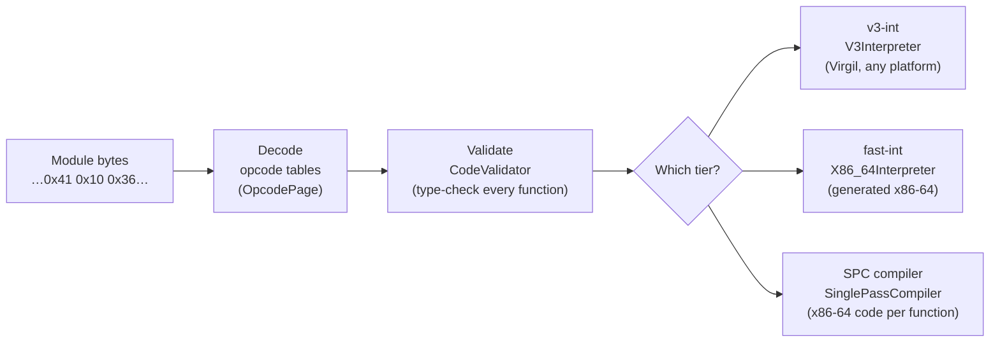

**Decoding.** Every opcode Wizard knows is a case of one big Virgil enum, [`Opcode`](https://github.com/timdrichards/wizard-engine/blob/2c8f1798cc02b8e8cab5eb2a5156227173026f5d/src/engine/Opcodes.v3#L9), about 590 of them. Each case carries its prefix, code, name (`mnemonic`), the kinds of immediates it has, and its type signature (what it pops and pushes). To turn bytes into an `Opcode`, Wizard looks them up in tables: one for single-byte opcodes and one [`OpcodePage`](https://github.com/timdrichards/wizard-engine/blob/2c8f1798cc02b8e8cab5eb2a5156227173026f5d/src/engine/Opcodes.v3#L758) per prefix byte.

**Validation.** Wasm promises that code is type-safe before it runs. Wizard's [`CodeValidator`](https://github.com/timdrichards/wizard-engine/blob/2c8f1798cc02b8e8cab5eb2a5156227173026f5d/src/engine/CodeValidator.v3) walks each function once, tracking the types on the stack and the nesting of blocks. It is a giant `match` over `Opcode`, one arm per instruction.

**Running.**

| Tier | What it is | Where it lives |
|---|---|---|
| **v3-int** | An interpreter written in plain Virgil. Slow and simple; runs anywhere Virgil runs, including the `v3i` target. Another giant `match` over `Opcode`. | [`V3Interpreter.v3`](https://github.com/timdrichards/wizard-engine/blob/2c8f1798cc02b8e8cab5eb2a5156227173026f5d/src/engine/v3/V3Interpreter.v3) |
| **fast-int** | An interpreter whose handlers are x86-64 machine code that Wizard generates at startup. A *dispatch table* maps each opcode to its handler. | [`X86_64Interpreter.v3`](https://github.com/timdrichards/wizard-engine/blob/2c8f1798cc02b8e8cab5eb2a5156227173026f5d/src/engine/x86-64/X86_64Interpreter.v3) |
| **SPC** | The single-pass compiler: whole Wasm functions to x86-64. If it meets something it can't compile, it *bails out* and the function stays in the interpreter. | [`SinglePassCompiler.v3`](https://github.com/timdrichards/wizard-engine/blob/2c8f1798cc02b8e8cab5eb2a5156227173026f5d/src/engine/compiler/SinglePassCompiler.v3) |

Wizard's `--mode` picks how these combine: `int`, `jit`, `lazy` or `dyn`. Our tests run every extension instruction in all four.

**Visitors.** Many tools inside Wizard walk bytecode (the compiler, monitors, the disassembler) using a [`BytecodeIterator`](https://github.com/timdrichards/wizard-engine/blob/2c8f1798cc02b8e8cab5eb2a5156227173026f5d/src/engine/BytecodeIterator.v3) that calls one method per instruction on a [`BytecodeVisitor`](https://github.com/timdrichards/wizard-engine/blob/2c8f1798cc02b8e8cab5eb2a5156227173026f5d/src/util/BytecodeVisitor.v3).

The pattern to notice: **every one of these places has a list of every instruction.** Adding an instruction the old way means editing all of them.

---

## 3. The problem, and Ben's house rules

We want an extension, say transactions, to live in its own folder, switched on at build time, without changes sprinkled through every giant `match`. In September 2026, Ben Titzer set out house rules:

1. Don't add fields to classes from outside the class.
2. **No per-case methods on enums, for now.**
3. **Extensible enums wait** for a stable Virgil language revision.
4. Have a configuration phase at build time where extensions register.
5. Support *fixed* opcode claims (real binary formats) and *leftover* ones (engine-internal).
6. Rely on opcode tables, not the enum, until the enum can be extended.
7. Visitors are an open problem.

Version 1 follows all of them. **Version 2 breaks rules 2 and 3 on purpose**, to answer one question: *once the language can do it, what would we gain?* It keeps the other five.

---

## 4. Open enums in five minutes

A Virgil enum today is closed: every case is in the declaration. Eliot's #653 adds two things.

**Per-case methods.** An enum can declare methods, and each case can override them in a body after its arguments:

```
enum Animal(legs: int) {
    CAT(4) { def speak() -> string { return "meow"; } },
    DUCK(2) { def speak() -> string { return "quack"; } },
    SNAKE(0);
    def speak() -> string { return "..."; }    // the default
}
Animal.DUCK.speak()   // "quack"
Animal.SNAKE.speak()  // "..."
```

**Open enums.** An enum whose case list ends with `_` is *open*. Another file can declare a *subtype enum* that adds cases:

```
// animals.v3
enum Animal(legs: int) {
    CAT(4), DUCK(2),
    _;
    def speak() -> string { return "..."; }
}

// farm.v3, maybe compiled, maybe not
enum Animal.Farm {
    COW(4) { def speak() -> string { return "moo"; } },
    PIG(4);
    def speak() -> string { return "oink"; }   // for every Farm case without its own
}
```

`Animal.Farm.COW` *is* an `Animal`. It has a tag (its number) after all of `Animal`'s own cases. `for (a in Animal)` visits it. `Animal.count` counts it. Overrides stack up the way you'd hope: **a case's own method beats its subtype enum's, which beats the root's.**

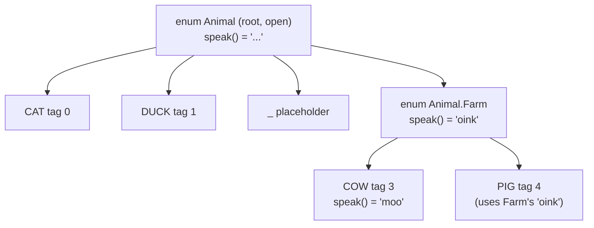

Two consequences matter a lot for Wizard:

- **The whole program still sees every case at compile time.** Virgil compiles the whole program at once. If `farm.v3` isn't compiled, `Animal.Farm` doesn't exist and `Animal` has just its own cases plus the `_` placeholder.
- **Code in `animals.v3` can't name `COW`.** It doesn't know about it. In a `match`, cases it doesn't know fall into the `_ =>` arm. That's fine, because the `_` arm can just call a method, and the method does the right thing for each case.

That second point is the whole trick of Version 2.

**How it's implemented, in one paragraph.** Each enum case gets a tag. A call to a per-case method looks the method up in a *method table* indexed by tag, one slot per case. So each method of an enum with 600 cases costs a 600-entry table. Remember that; it comes back when we measure size. Eliot's branch also adds a compiler option, `-compact-mtable`, that shrinks such tables when most entries are the same.

---

## 5. The big idea of Version 2

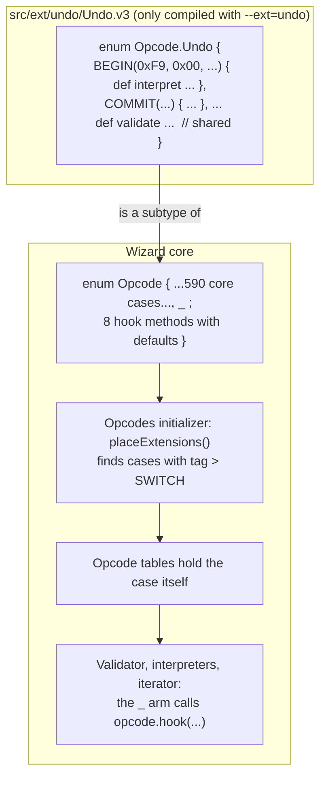

In words:

- **`Opcode` becomes open**, and gains eight hook methods with harmless defaults ([`Opcodes.v3` lines 622 to 644](https://github.com/timdrichards/wizard-engine/blob/2c8f1798cc02b8e8cab5eb2a5156227173026f5d/src/engine/Opcodes.v3#L622-L644)).
- **An extension is a subtype enum**, `enum Opcode.Undo { ... }`, and **each instruction is a case** that overrides the hooks it needs.
- **Compiling the extension's file is all it takes** to register it. No list, no generated file.
- **The tables hold the case itself.** No placeholder, no side table.
- **Every giant `match` already has a `_ =>` arm** for "something I don't know". That arm now calls the case's hook.

Compared with Version 1, a lot of scaffolding just evaporates:

| Version 1 needed | Version 2 |
|---|---|
| `class ExtOpcode`, one subclass per instruction | one enum case per instruction |
| `Opcode.EXT`, "look in the side table" | gone: the case is in the table |
| a parallel `Array<ExtOpcode>` next to each table | gone |
| `CodePtr.ext_opcode_at`, a second lookup | gone: decoding returns the case |
| `class InstrExtension` and its `opcodes()` list | gone: the subtype enum is the extension |
| `extension.txt` and a generated registration list | gone: compiling the file registers it |
| `OpcodeClaim.FIXED` / `FLOATING` | fixed by default; a floating case overrides `isFloating()` |

---

## 6. Anatomy of an extension instruction

The hooks, as declared on the core `Opcode` ([source](https://github.com/timdrichards/wizard-engine/blob/2c8f1798cc02b8e8cab5eb2a5156227173026f5d/src/engine/Opcodes.v3#L622-L644)):

```
enum Opcode(prefix: u8, code: u16, mnemonic: string, imms: Array<ImmKind>, sig: SigDecl) {
    ..., SWITCH(0x00, 0xE6, "switch", imm.CONT_TAG, null),
    _;
    def validate(v: CodeValidator) -> bool { return true; }
    def interpret(f: ExtFrame) -> TrapReason { return TrapReason.UNIMPLEMENTED; }
    def accept(v: BytecodeVisitor) { v.visitExt(this); }
    def isFloating() -> bool { return false; }
    def opensBlock() -> bool { return false; }
    def onEnd(v: CodeValidator, pos: int) { }
    def onBranchOut(v: CodeValidator) -> bool { return true; }
    def endsBlock() -> bool { return false; }
}
```

The core never calls these for its own 590 opcodes. They're only reached through the `_` arms, for extension cases.

| Hook | Who calls it | What it is for |
|---|---|---|
| [`validate`](https://github.com/timdrichards/wizard-engine/blob/2c8f1798cc02b8e8cab5eb2a5156227173026f5d/src/engine/Opcodes.v3#L628) | the validator | Checks beyond the type signature. If `sig` is null, it does the stack typing itself. |
| [`interpret`](https://github.com/timdrichards/wizard-engine/blob/2c8f1798cc02b8e8cab5eb2a5156227173026f5d/src/engine/Opcodes.v3#L631) | both interpreters | What the instruction does. Returns `NONE` or a reason to trap. |
| [`accept`](https://github.com/timdrichards/wizard-engine/blob/2c8f1798cc02b8e8cab5eb2a5156227173026f5d/src/engine/Opcodes.v3#L633) | bytecode iterators | Shows the instruction to a visitor. |
| [`isFloating`](https://github.com/timdrichards/wizard-engine/blob/2c8f1798cc02b8e8cab5eb2a5156227173026f5d/src/engine/Opcodes.v3#L636) | placement | True for an internal one-byte instruction that can sit in any free slot. |
| [`opensBlock`, `onEnd`, `onBranchOut`, `endsBlock`](https://github.com/timdrichards/wizard-engine/blob/2c8f1798cc02b8e8cab5eb2a5156227173026f5d/src/engine/Opcodes.v3#L641-L644) | the validator | For block-shaped instructions; see [chapter 11](#11-instructions-shaped-like-blocks). |

And here is `undo.begin`, the whole thing:

```
BEGIN(0xF9, 0x00, "undo.begin", ImmSigs.NONE, SigCache.v_v) {
    def interpret(f: ExtFrame) -> TrapReason { return UndoLogs.of(f.instance()).begin(); }
},
```

One case: its encoding, name, immediates and signature as arguments, and its behavior in the body. Shared rules go on the subtype enum, once ([`Opcode.Undo.validate`](https://github.com/timdrichards/wizard-engine/blob/2c8f1798cc02b8e8cab5eb2a5156227173026f5d/src/ext/undo/Undo.v3#L36)).

**The `ExtFrame`.** [`ExtFrame`](https://github.com/timdrichards/wizard-engine/blob/2c8f1798cc02b8e8cab5eb2a5156227173026f5d/src/engine/ExtFrame.v3#L6) is what `interpret` sees of the running program:

```
class ExtFrame {
    def imm = CodePtr.new(null);    // positioned at the instruction's immediates
    def instance() -> Instance;
    def pop(t: ValueType) -> Value;
    def push(v: Value);
    def popi() -> i32;  def pushi(v: i32);
}
```

The Virgil interpreter supplies [`V3ExtFrame`](https://github.com/timdrichards/wizard-engine/blob/2c8f1798cc02b8e8cab5eb2a5156227173026f5d/src/engine/v3/V3Interpreter.v3#L2253) and the fast interpreter supplies [`NativeExtFrame`](https://github.com/timdrichards/wizard-engine/blob/2c8f1798cc02b8e8cab5eb2a5156227173026f5d/src/engine/x86-64/X86_64Runtime.v3#L275). This is identical to Version 1.

**Still no `super`.** Virgil has no `super.method()` in either version. A case that wants "the subtype's check, plus one more thing" calls a named helper, such as `inTransaction(v)`, that the subtype enum provides.

---

## 7. Turning an extension on: the build

An extension lives in `src/ext/<name>/*.v3`, its tests in `test/ext/<name>/`. Build with:

```
./build.sh --ext=undo,ministe wizeng x86-64-linux
```

The whole of the build change is a loop ([`build.sh` lines 147 to 162](https://github.com/timdrichards/wizard-engine/blob/2c8f1798cc02b8e8cab5eb2a5156227173026f5d/build.sh#L147-L162)):

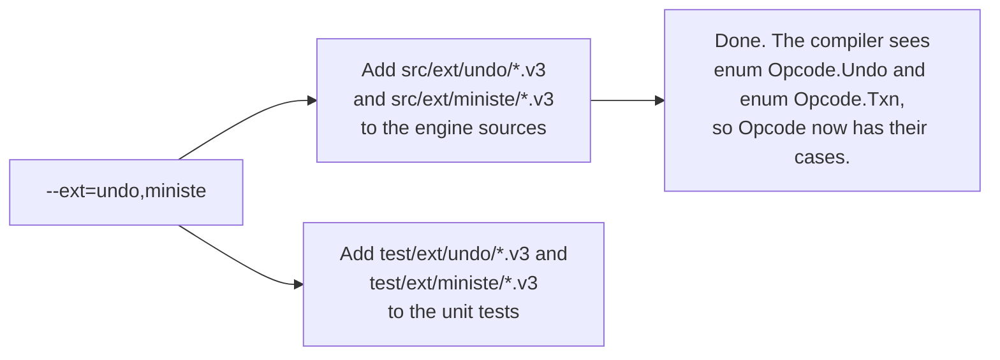

No `extension.txt`. No generated list. The flag *is* the list. An unknown name lists the extensions that do exist, as a courtesy.

This also means **you can't forget to register an instruction.** In Version 1, adding an `ExtOpcode` class and forgetting to add it to `opcodes()` compiles fine and fails later with "unsupported opcode". In Version 2 there's nothing to forget: if the case is in a compiled file, it's in `Opcode`.

Without `--ext`, the extension files aren't compiled, `Opcode` has its core cases plus the lonely `_`, and an unextended Wizard carries very little extra (see [chapter 19](#19-how-it-measures-up)).

---

## 8. Finding a seat: opcode placement

Every extension case needs an encoding. This happens in the [`Opcodes`](https://github.com/timdrichards/wizard-engine/blob/2c8f1798cc02b8e8cab5eb2a5156227173026f5d/src/engine/Opcodes.v3#L837) component initializer, which Virgil runs *at compile time*, so the tables are baked into the binary. That's Ben's configuration phase (rule 4).

**Telling core from extension.** Core cases come first in tag order, ending with `SWITCH`. So [`LAST_CORE_TAG`](https://github.com/timdrichards/wizard-engine/blob/2c8f1798cc02b8e8cab5eb2a5156227173026f5d/src/engine/Opcodes.v3#L853) is `Opcode.SWITCH.tag`, and [`isExt(op)`](https://github.com/timdrichards/wizard-engine/blob/2c8f1798cc02b8e8cab5eb2a5156227173026f5d/src/engine/Opcodes.v3#L882) is just `op.tag > LAST_CORE_TAG`. One comparison, no lookups.

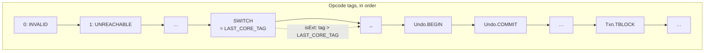

The initializer places core cases as before, [skipping extension cases](https://github.com/timdrichards/wizard-engine/blob/2c8f1798cc02b8e8cab5eb2a5156227173026f5d/src/engine/Opcodes.v3#L861), and then calls [`placeExtensions()`](https://github.com/timdrichards/wizard-engine/blob/2c8f1798cc02b8e8cab5eb2a5156227173026f5d/src/engine/Opcodes.v3#L892):

1. **Collect** every case with `isExt(op)`, skipping the `_` placeholder (it has no mnemonic).
2. **Fixed cases first** ([`placeFixed`](https://github.com/timdrichards/wizard-engine/blob/2c8f1798cc02b8e8cab5eb2a5156227173026f5d/src/engine/Opcodes.v3#L906)): exactly at their prefix and code. If the prefix byte isn't a prefix yet and nobody uses it, it becomes one, with a new page just for this extension ([`addExtPage`](https://github.com/timdrichards/wizard-engine/blob/2c8f1798cc02b8e8cab5eb2a5156227173026f5d/src/engine/Opcodes.v3#L948)). That's how undo gets `0xF9` and ministe gets `0xFA`.
3. **Floating cases second** ([`placeFloating`](https://github.com/timdrichards/wizard-engine/blob/2c8f1798cc02b8e8cab5eb2a5156227173026f5d/src/engine/Opcodes.v3#L930)): the first free one-byte slot ([`slotUser`](https://github.com/timdrichards/wizard-engine/blob/2c8f1798cc02b8e8cab5eb2a5156227173026f5d/src/engine/Opcodes.v3#L941) says who's sitting where). The declared code of a floating case is ignored. The real one is kept in [`floating_code[tag]`](https://github.com/timdrichards/wizard-engine/blob/2c8f1798cc02b8e8cab5eb2a5156227173026f5d/src/engine/Opcodes.v3#L857), and [`codeOf(op)`](https://github.com/timdrichards/wizard-engine/blob/2c8f1798cc02b8e8cab5eb2a5156227173026f5d/src/engine/Opcodes.v3#L886) gives the code an opcode really has.
4. **Keep the list** in [`ext_opcodes`](https://github.com/timdrichards/wizard-engine/blob/2c8f1798cc02b8e8cab5eb2a5156227173026f5d/src/engine/Opcodes.v3#L855), for the fast interpreter.

A collision stops the build with an error naming both opcodes. (Before this work, `OpcodePage.put` would silently let the later one win.)

What goes in the table is **the case itself**, put there by [`OpcodePage.placeAt`](https://github.com/timdrichards/wizard-engine/blob/2c8f1798cc02b8e8cab5eb2a5156227173026f5d/src/engine/Opcodes.v3#L801):

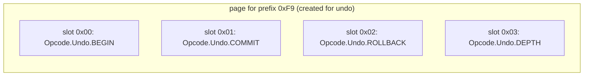

Compare that with Version 1's table of `Opcode.EXT` placeholders plus a side table. Decoding bytes now returns the real instruction in one step, everywhere, with no new decoding code at all.

This is the same algorithm as Version 1, run over enum cases instead of descriptor objects.

---

## 9. One instruction, four ways to run it

Let's follow `undo.begin` (bytes `0xF9 0x00`) everywhere.

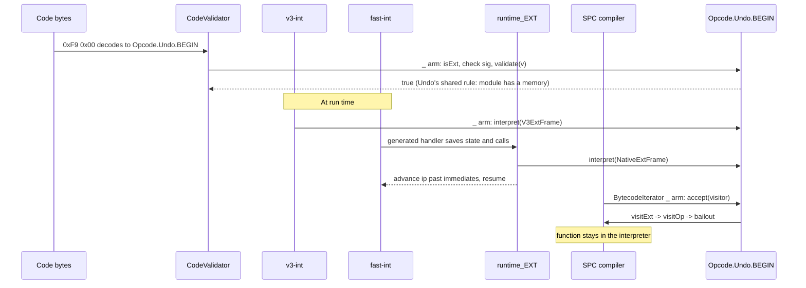

**The validator** (the [`_` arm, line 1387](https://github.com/timdrichards/wizard-engine/blob/2c8f1798cc02b8e8cab5eb2a5156227173026f5d/src/engine/CodeValidator.v3#L1387)). The core validator's `match` already had a `_` arm for opcodes with a plain signature. It now starts with `if (Opcodes.isExt(opcode))`, and then:

1. If it has a signature, check it like any core instruction.
2. If it opens a block, open one ([chapter 11](#11-instructions-shaped-like-blocks)).
3. Call `opcode.validate(this)`.
4. Skip past its immediates, whatever the hook read.

**v3-int** (the [`_` arm, line 1402](https://github.com/timdrichards/wizard-engine/blob/2c8f1798cc02b8e8cab5eb2a5156227173026f5d/src/engine/v3/V3Interpreter.v3#L1402)): point the frame's `imm` reader at the immediates, call `opcode.interpret(extFrame)`, skip the immediates, trap if asked. The frame is made on first use ([line 7](https://github.com/timdrichards/wizard-engine/blob/2c8f1798cc02b8e8cab5eb2a5156227173026f5d/src/engine/v3/V3Interpreter.v3#L7)).

**fast-int.** At startup, [`genExtHandlers`](https://github.com/timdrichards/wizard-engine/blob/2c8f1798cc02b8e8cab5eb2a5156227173026f5d/src/engine/x86-64/X86_64Interpreter.v3#L4102) (called at [line 946](https://github.com/timdrichards/wizard-engine/blob/2c8f1798cc02b8e8cab5eb2a5156227173026f5d/src/engine/x86-64/X86_64Interpreter.v3#L946)) makes one small machine-code handler per case in `Opcodes.ext_opcodes` and writes it into the dispatch table at `codeOf(case)` ([`patchDispatchTableAt`](https://github.com/timdrichards/wizard-engine/blob/2c8f1798cc02b8e8cab5eb2a5156227173026f5d/src/engine/x86-64/X86_64Interpreter.v3#L4044)). Each handler saves registers, calls [`runtime_EXT`](https://github.com/timdrichards/wizard-engine/blob/2c8f1798cc02b8e8cab5eb2a5156227173026f5d/src/engine/x86-64/X86_64Runtime.v3#L72), restores them, and dispatches the next instruction. `runtime_EXT` re-reads the opcode at the current position, checks `isExt`, calls `interpret`, and nudges the saved instruction pointer past any immediates. No extensions, no handlers.

**SPC, the compiler.** The `BytecodeIterator` gained one line, [`_ => opcode.accept(v)`](https://github.com/timdrichards/wizard-engine/blob/2c8f1798cc02b8e8cab5eb2a5156227173026f5d/src/engine/BytecodeIterator.v3#L204). The default `accept` calls [`visitExt(op)`](https://github.com/timdrichards/wizard-engine/blob/2c8f1798cc02b8e8cab5eb2a5156227173026f5d/src/util/BytecodeVisitor.v3#L21), whose default calls `visitOp(op)`, and the compiler's [`visitOp`](https://github.com/timdrichards/wizard-engine/blob/2c8f1798cc02b8e8cab5eb2a5156227173026f5d/src/engine/compiler/SinglePassCompiler.v3#L389) bails out. That's the existing behavior for anything the compiler doesn't know: **the function stays in the interpreter, and everything else still compiles.** The compiler itself didn't change.

So, as in Version 1, an extension that writes only `validate` and `interpret` works correctly in every tier. Going *fast* (hand-written handlers, compiler support) is an optional later step that we did not build.

**Visitors.** `visitExt(op: Opcode)` is the one new visitor method. Visitors that only care about stack effects read `op.sig`; visitors that care about one instruction override `visitExt` and compare `op == Opcode.Txn.TBLOCK`; an extension that must change how some visitor sees it overrides `accept`. Same answer as Version 1, but the visitor gets the real case, which reads more naturally.

Two core loops that walk every opcode now skip extension cases: [`OpcodeMap`](https://github.com/timdrichards/wizard-engine/blob/2c8f1798cc02b8e8cab5eb2a5156227173026f5d/src/util/OpcodeMap.v3#L96) and the [Whamm monitor](https://github.com/timdrichards/wizard-engine/blob/2c8f1798cc02b8e8cab5eb2a5156227173026f5d/src/monitors/WhammMonitor.v3#L53).

---

## 10. Watching memory: the write observer and page tracking

This machinery is **identical in both versions**, line for line. It's here so this guide stands on its own.

To undo a write, you must save the old bytes *before* the write. The writes we care about come from plain `i32.store`, `memory.fill`, called functions and compiled code, not from our new instructions. So we need to see **every write to memory**, from every tier, without slowing down programs that don't care. Two tricks.

### Trick one: a write observer, for Virgil code

[`Memory`](https://github.com/timdrichards/wizard-engine/blob/2c8f1798cc02b8e8cab5eb2a5156227173026f5d/src/engine/Memory.v3#L14) gains a `writeObserver` field and two methods, [`write_range_oil_64`](https://github.com/timdrichards/wizard-engine/blob/2c8f1798cc02b8e8cab5eb2a5156227173026f5d/src/engine/Memory.v3#L88) and [`write_range_ol_64`](https://github.com/timdrichards/wizard-engine/blob/2c8f1798cc02b8e8cab5eb2a5156227173026f5d/src/engine/Memory.v3#L94), which return the same byte range as the read versions but first tell the [`MemoryWriteObserver`](https://github.com/timdrichards/wizard-engine/blob/2c8f1798cc02b8e8cab5eb2a5156227173026f5d/src/engine/Memory.v3#L236) "these bytes are about to change". Every Virgil write path uses them: the v3 interpreter's stores (via [`decodeMemArgAndGetMemoryRangeForWrite`](https://github.com/timdrichards/wizard-engine/blob/2c8f1798cc02b8e8cab5eb2a5156227173026f5d/src/engine/v3/V3Interpreter.v3#L1426), covering plain, lane and atomic stores) and the bulk operations (`memory.fill`, `memory.copy`, `memory.init`, host reads into memory). With no observer: one null check per write.

### Trick two: page protection, for machine code

The fast interpreter and compiled code store straight to memory with one machine instruction. There's no Virgil method to hook. So: **make the memory read-only and let the hardware tell us.**

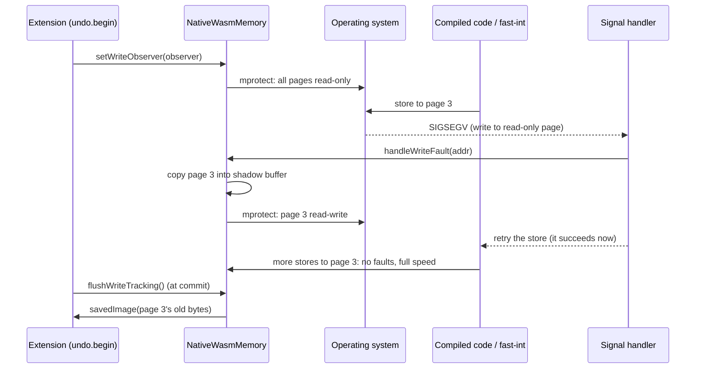

In [`NativeMemory.v3`](https://github.com/timdrichards/wizard-engine/blob/2c8f1798cc02b8e8cab5eb2a5156227173026f5d/src/engine/native/NativeMemory.v3#L79):

1. [`startTracking`](https://github.com/timdrichards/wizard-engine/blob/2c8f1798cc02b8e8cab5eb2a5156227173026f5d/src/engine/native/NativeMemory.v3#L127) allocates a shadow buffer the size of the memory and makes every 4 KiB page read-only.
2. The first store to a page faults. Both signal handlers, the [fast interpreter's](https://github.com/timdrichards/wizard-engine/blob/2c8f1798cc02b8e8cab5eb2a5156227173026f5d/src/engine/x86-64/X86_64Interpreter.v3#L147) and the [compiler's](https://github.com/timdrichards/wizard-engine/blob/2c8f1798cc02b8e8cab5eb2a5156227173026f5d/src/engine/x86-64/X86_64SinglePassCompiler.v3#L1295), first ask [`NativeMemoryTracking.handleWriteFault`](https://github.com/timdrichards/wizard-engine/blob/2c8f1798cc02b8e8cab5eb2a5156227173026f5d/src/engine/native/NativeMemory.v3#L182).
3. [`handleWriteFault`](https://github.com/timdrichards/wizard-engine/blob/2c8f1798cc02b8e8cab5eb2a5156227173026f5d/src/engine/native/NativeMemory.v3#L115) copies the page into the shadow buffer, unlocks it, and says "retry". No allocation in the signal handler.
4. Later stores to that page run at full speed.
5. [`flushWriteTracking`](https://github.com/timdrichards/wizard-engine/blob/2c8f1798cc02b8e8cab5eb2a5156227173026f5d/src/engine/native/NativeMemory.v3#L87) reports saved pages to the observer as `savedImage`; [`restartWriteTracking`](https://github.com/timdrichards/wizard-engine/blob/2c8f1798cc02b8e8cab5eb2a5156227173026f5d/src/engine/native/NativeMemory.v3#L96) locks every page again, so a nested checkpoint sees its own first writes.

Writes through `write_range_*` save and unlock their pages directly ([`openPages`](https://github.com/timdrichards/wizard-engine/blob/2c8f1798cc02b8e8cab5eb2a5156227173026f5d/src/engine/native/NativeMemory.v3#L145)), so Virgil code never faults. The result: the v3 interpreter reports every write byte by byte, native code reports first writes page by page, and either way the observer gets "here are the old bytes at this position". No generated code changed.

---

## 11. Instructions shaped like blocks

Real transactions look like Wasm blocks:

```
tblock
  ...stores...
end          ;; commits here
```

Two hard parts: the interpreter runs `end` without knowing which block it closes, and a branch can leave a block without reaching its `end`. The answer is the same as Version 1, all in the validator:

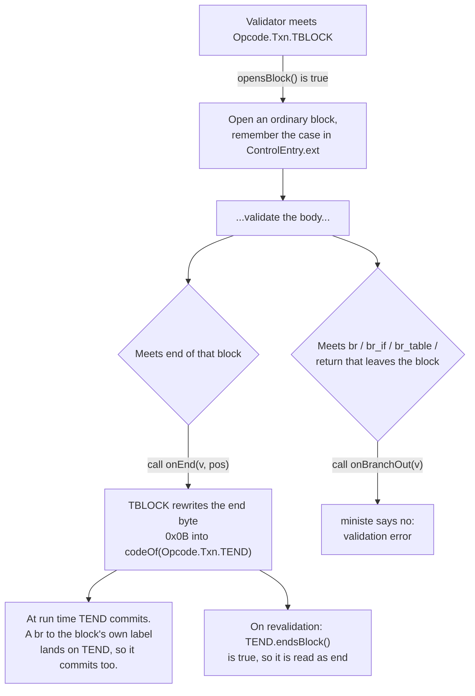

The pieces in Version 2:

- [`ControlEntry.ext`](https://github.com/timdrichards/wizard-engine/blob/2c8f1798cc02b8e8cab5eb2a5156227173026f5d/src/engine/CodeValidator.v3#L1873) is an `Opcode`, with `INVALID` meaning "not an extension block".
- At `end`, the validator calls [`ctl.ext.onEnd(this, pos)`](https://github.com/timdrichards/wizard-engine/blob/2c8f1798cc02b8e8cab5eb2a5156227173026f5d/src/engine/CodeValidator.v3#L394).
- [`rewriteOpcode(pos, op)`](https://github.com/timdrichards/wizard-engine/blob/2c8f1798cc02b8e8cab5eb2a5156227173026f5d/src/engine/CodeValidator.v3#L1809) writes `Opcodes.codeOf(op)`, so a floating case lands on its real byte.
- Before the big `match`, an extension case with `endsBlock()` [is read as `END`](https://github.com/timdrichards/wizard-engine/blob/2c8f1798cc02b8e8cab5eb2a5156227173026f5d/src/engine/CodeValidator.v3#L247), which makes revalidation work.
- [`checkBranchOut`](https://github.com/timdrichards/wizard-engine/blob/2c8f1798cc02b8e8cab5eb2a5156227173026f5d/src/engine/CodeValidator.v3#L1794) runs at `br`, `br_if`, `br_table` and `return`.
- [`inBlockOf(op)`](https://github.com/timdrichards/wizard-engine/blob/2c8f1798cc02b8e8cab5eb2a5156227173026f5d/src/engine/CodeValidator.v3#L1802) answers "am I inside a block opened by `op`?". It replaces Version 1's `enclosingExt(owner)`, and reads better: `v.inBlockOf(Opcode.Txn.TBLOCK)`.

Wizard already rewrites bytecode in place for probes, so rewriting `end` isn't as wild as it sounds. Eliot's transactional Wizard does the same thing for transaction ends.

---

## 12. Where an extension keeps its stuff

Identical to Version 1. `Instance` gets one core-declared field, [`ext_state`](https://github.com/timdrichards/wizard-engine/blob/2c8f1798cc02b8e8cab5eb2a5156227173026f5d/src/engine/Instance.v3#L83), the head of a chain of [`InstanceExtState`](https://github.com/timdrichards/wizard-engine/blob/2c8f1798cc02b8e8cab5eb2a5156227173026f5d/src/engine/Instance.v3#L178) objects. An extension subclasses it and finds its own link by type, creating it on first use (see [`UndoLogs.of`](https://github.com/timdrichards/wizard-engine/blob/2c8f1798cc02b8e8cab5eb2a5156227173026f5d/src/ext/undo/Undo.v3#L116)). No fields bolted on from outside (rule 1). When Virgil has weak maps, this becomes a weak map.

---

## 13. Extension one: undo

Undo is the proof of concept, in [`src/ext/undo/Undo.v3`](https://github.com/timdrichards/wizard-engine/blob/2c8f1798cc02b8e8cab5eb2a5156227173026f5d/src/ext/undo/Undo.v3) (125 lines). It gives Wasm code checkpoints on memory 0:

| Instruction | Bytes | Stack | What it does |
|---|---|---|---|
| `undo.begin` | `0xF9 0x00` | `[] -> []` | open a checkpoint |
| `undo.commit` | `0xF9 0x01` | `[] -> []` | keep the writes since the innermost checkpoint, and close it |
| `undo.rollback` | `0xF9 0x02` | `[] -> []` | put back every byte written since the innermost checkpoint, and close it |
| `undo.depth` | `0xF9 0x03` | `[] -> [i32]` | how many checkpoints are open |

Committing an inner checkpoint folds its writes into the outer one. `commit` or `rollback` with nothing open traps. A module with no memory is rejected.

The whole instruction set is one enum ([source](https://github.com/timdrichards/wizard-engine/blob/2c8f1798cc02b8e8cab5eb2a5156227173026f5d/src/ext/undo/Undo.v3#L18)):

```
enum Opcode.Undo {
    BEGIN(0xF9, 0x00, "undo.begin", ImmSigs.NONE, SigCache.v_v) {
        def interpret(f: ExtFrame) -> TrapReason { return UndoLogs.of(f.instance()).begin(); }
    },
    COMMIT(0xF9, 0x01, "undo.commit", ImmSigs.NONE, SigCache.v_v) {
        def interpret(f: ExtFrame) -> TrapReason { return UndoLogs.of(f.instance()).commit(); }
    },
    ROLLBACK(0xF9, 0x02, "undo.rollback", ImmSigs.NONE, SigCache.v_v) {
        def interpret(f: ExtFrame) -> TrapReason { return UndoLogs.of(f.instance()).rollback(); }
    },
    DEPTH(0xF9, 0x03, "undo.depth", ImmSigs.NONE, SigCache.v_i) {
        def interpret(f: ExtFrame) -> TrapReason {
            f.pushi(UndoLogs.of(f.instance()).depth());
            return TrapReason.NONE;
        }
    };

    // Every undo instruction acts on memory 0, so the module must have one.
    def validate(v: CodeValidator) -> bool {
        if (v.module.memories.length > 0) return true;
        v.err_atpc().OobIndex("memory", 0, 0);
        return false;
    }
}
```

That's the entire "instruction" half of the extension. The rest is the undo log, which is unchanged from Version 1.

A tiny program, in Wasm text with our new instructions:

```
(memory 1)
(func
  (i32.store (i32.const 16) (i32.const 42))  ;; mem[16] = 42
  undo.begin
    (i32.store (i32.const 16) (i32.const 99))  ;; mem[16] = 99
    undo.rollback                              ;; mem[16] is 42 again
)
```

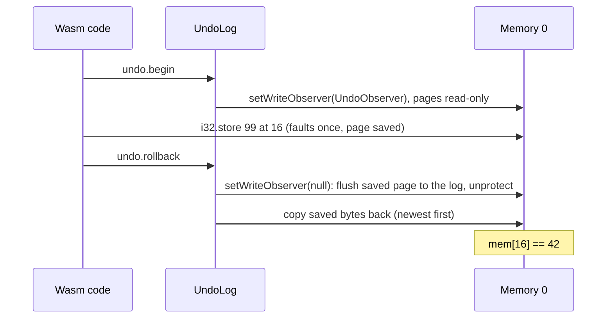

- [`UndoLog`](https://github.com/timdrichards/wizard-engine/blob/2c8f1798cc02b8e8cab5eb2a5156227173026f5d/src/ext/undo/Undo.v3#L47) keeps (position, old bytes) pairs and a stack of `marks`, one per open checkpoint. [`begin`](https://github.com/timdrichards/wizard-engine/blob/2c8f1798cc02b8e8cab5eb2a5156227173026f5d/src/ext/undo/Undo.v3#L53) installs the observer (or restarts tracking, if nested) and pushes a mark; [`commit`](https://github.com/timdrichards/wizard-engine/blob/2c8f1798cc02b8e8cab5eb2a5156227173026f5d/src/ext/undo/Undo.v3#L60) pops it; [`rollback`](https://github.com/timdrichards/wizard-engine/blob/2c8f1798cc02b8e8cab5eb2a5156227173026f5d/src/ext/undo/Undo.v3#L67) stops tracking, copies old bytes back newest first (so the oldest copy of each byte wins), and trims.
- [`UndoObserver`](https://github.com/timdrichards/wizard-engine/blob/2c8f1798cc02b8e8cab5eb2a5156227173026f5d/src/ext/undo/Undo.v3#L105) bridges memory to log.

**Tests** ([`test/ext/undo/UndoTest.v3`](https://github.com/timdrichards/wizard-engine/blob/2c8f1798cc02b8e8cab5eb2a5156227173026f5d/test/ext/undo/UndoTest.v3), the same file as Version 1): depth, commit and rollback, nesting both ways, unaligned mixed-width stores, `memory.fill`, `memory.copy`, nothing-open traps, stores from a compiled callee, stores on two pages, and the no-memory validation rule.

---

## 14. Extension two: ministe

Ministe is a single-threaded mini version of the Wasm Simple Transactions proposal (STE), with STE's encodings on prefix `0xFA`, in [`src/ext/ministe/MiniSte.v3`](https://github.com/timdrichards/wizard-engine/blob/2c8f1798cc02b8e8cab5eb2a5156227173026f5d/src/ext/ministe/MiniSte.v3) (204 lines).

| Instruction | Bytes | Stack | What it does |
|---|---|---|---|
| `tblock <type> ... end` | `0xFA 0x02` | like `block` | run the body as a transaction, which commits at its `end` |
| `tfail` | `0xFA 0x0F` | `[i32] -> []` | roll back every open transaction, then trap |
| `tglobal.get <g>` | `0xFA 0x23` | `[] -> [t]` | read a global |
| `tglobal.set <g>` | `0xFA 0x24` | `[t] -> []` | write a global; undone if the transaction fails |
| `i32.tload <memarg>` | `0xFA 0x28` | `[i32] -> [i32]` | load from memory 0 |
| `i32.tstore <memarg>` | `0xFA 0x36` | `[i32 i32] -> []` | store to memory 0 |
| `tend` | any free byte | `[] -> []` | internal: what each `tblock`'s `end` becomes; commits |

Everything but `tblock` must be inside a `tblock`. Not in the subset: `tblock`'s `else`, `ttry`, and branches or returns out of a `tblock` (rejected). With no `ttry`, nothing can catch a failure, so `tfail` rolls back everything and traps.

The block-shaped part, where the hooks work together ([source](https://github.com/timdrichards/wizard-engine/blob/2c8f1798cc02b8e8cab5eb2a5156227173026f5d/src/ext/ministe/MiniSte.v3#L20)):

```
enum Opcode.Txn {
    TBLOCK(0xFA, 0x02, "tblock", ImmSigs.BLOCKT, null) {
        def opensBlock() -> bool { return true; }
        def validate(v: CodeValidator) -> bool { return true; } // may appear anywhere
        def onEnd(v: CodeValidator, pos: int) { v.rewriteOpcode(pos, Opcode.Txn.TEND); }
        def onBranchOut(v: CodeValidator) -> bool { ...error...; return false; }
        def interpret(f: ExtFrame) -> TrapReason { TxnLogs.of(f.instance()).begin(); return TrapReason.NONE; }
    },
    TEND(0x00, 0x00, "tend", ImmSigs.NONE, SigCache.v_v) {
        def isFloating() -> bool { return true; }
        def endsBlock() -> bool { return true; }
        def validate(v: CodeValidator) -> bool { return true; }
        def interpret(f: ExtFrame) -> TrapReason { TxnLogs.of(f.instance()).commit(); return TrapReason.NONE; }
    },
    TFAIL(...), TGLOBAL_GET(...), TGLOBAL_SET(...), I32_TLOAD(...), I32_TSTORE(...);

    // Every transaction instruction but tblock must be inside a tblock.
    def validate(v: CodeValidator) -> bool { return inTransaction(v); }
    def inTransaction(v: CodeValidator) -> bool {
        if (v.inBlockOf(Opcode.Txn.TBLOCK)) return true;
        ...error...
    }
}
```

Notice `TBLOCK` and `TEND` override `validate` to `return true`, opting out of the "must be inside a `tblock`" rule that every other case inherits from the subtype.

| Needs | Where |
|---|---|
| immediates (block type, global index, memory argument) | `ExtFrame.imm`; `v.parser` in `validate` |
| a block-shaped instruction and code at its end | [`TBLOCK`](https://github.com/timdrichards/wizard-engine/blob/2c8f1798cc02b8e8cab5eb2a5156227173026f5d/src/ext/ministe/MiniSte.v3#L21) |
| a floating one-byte opcode | [`TEND`](https://github.com/timdrichards/wizard-engine/blob/2c8f1798cc02b8e8cab5eb2a5156227173026f5d/src/ext/ministe/MiniSte.v3#L36) |
| nesting rules | [`inTransaction`](https://github.com/timdrichards/wizard-engine/blob/2c8f1798cc02b8e8cab5eb2a5156227173026f5d/src/ext/ministe/MiniSte.v3#L119), using `inBlockOf` |
| a type that depends on an immediate | [`TGLOBAL_GET`](https://github.com/timdrichards/wizard-engine/blob/2c8f1798cc02b8e8cab5eb2a5156227173026f5d/src/ext/ministe/MiniSte.v3#L57) and [`TGLOBAL_SET`](https://github.com/timdrichards/wizard-engine/blob/2c8f1798cc02b8e8cab5eb2a5156227173026f5d/src/ext/ministe/MiniSte.v3#L70) have a null `sig` and pop and push in `validate` |
| memory-0-only loads and stores | [`memoryZero`](https://github.com/timdrichards/wizard-engine/blob/2c8f1798cc02b8e8cab5eb2a5156227173026f5d/src/ext/ministe/MiniSte.v3#L125) |

The life of a transaction:

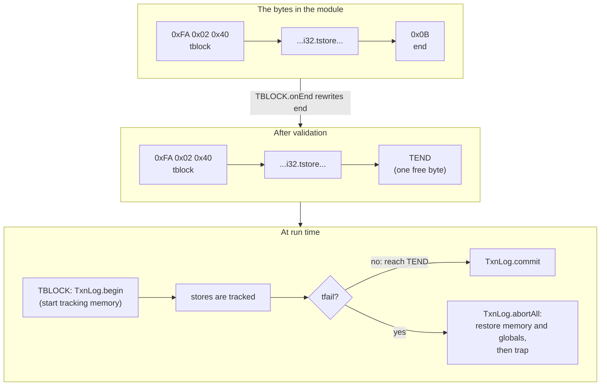

[`TxnLog`](https://github.com/timdrichards/wizard-engine/blob/2c8f1798cc02b8e8cab5eb2a5156227173026f5d/src/ext/ministe/MiniSte.v3#L135), with [`begin`](https://github.com/timdrichards/wizard-engine/blob/2c8f1798cc02b8e8cab5eb2a5156227173026f5d/src/ext/ministe/MiniSte.v3#L142), [`commit`](https://github.com/timdrichards/wizard-engine/blob/2c8f1798cc02b8e8cab5eb2a5156227173026f5d/src/ext/ministe/MiniSte.v3#L151) and [`abortAll`](https://github.com/timdrichards/wizard-engine/blob/2c8f1798cc02b8e8cab5eb2a5156227173026f5d/src/ext/ministe/MiniSte.v3#L158), saves old memory bytes and old global values. It's unchanged from Version 1.

**Tests** ([`test/ext/ministe/MiniSteTest.v3`](https://github.com/timdrichards/wizard-engine/blob/2c8f1798cc02b8e8cab5eb2a5156227173026f5d/test/ext/ministe/MiniSteTest.v3), the same file as Version 1): commit at the end; `br` to the block's own end commits; `tload`; `tfail` rolls back memory, a nested transaction, a compiled callee's store, and a global; `tglobal.set` commits; and validation rejects `tstore` and `tfail` outside a `tblock` and `br` and `return` out of one, while accepting valid nesting.

With undo and the framework's own tests: **108 passing on the four x86-64 tiers and 36 on `v3i`**, the same counts as Version 1.

---

## 15. Everything that changed in Wizard

Against master [`5d5f84a2`](https://github.com/timdrichards/wizard-engine/commit/5d5f84a2aa9c9bc07428f126d9bfd533fbe36078): **450 lines added and 29 removed in 14 core files**, versus Version 1's 558 and 29 in 16. Full diff: [master...ext-v2](https://github.com/timdrichards/wizard-engine/compare/5d5f84a2aa9c9bc07428f126d9bfd533fbe36078...2c8f1798cc02b8e8cab5eb2a5156227173026f5d).

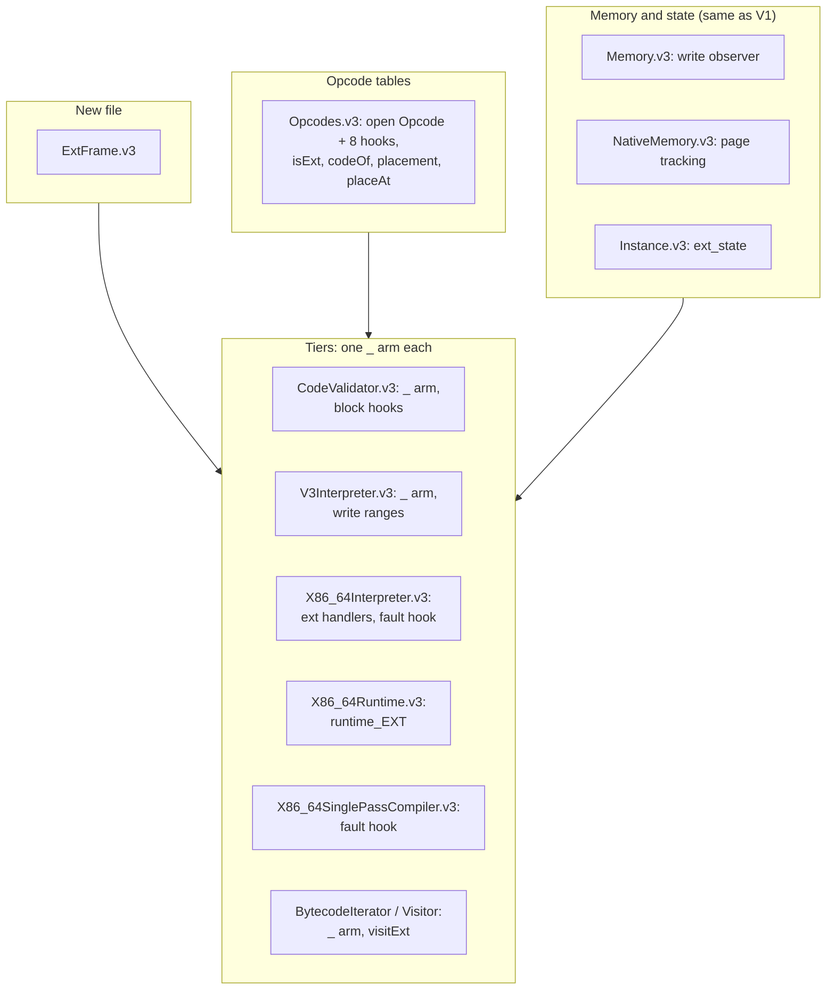

| File | Lines | What changed |
|---|---|---|
| [`src/engine/Opcodes.v3`](https://github.com/timdrichards/wizard-engine/blob/2c8f1798cc02b8e8cab5eb2a5156227173026f5d/src/engine/Opcodes.v3#L622) | +135 | `_` and the eight hooks on `Opcode`; `LAST_CORE_TAG`, `isExt`, `codeOf`, `ext_opcodes`, `floating_code`; `placeExtensions`, `placeFixed`, `placeFloating`, `slotUser`, `addExtPage`; `OpcodePage.placeAt`; `findByName` skips the placeholder; scratch pages no longer bump the global subpage count |
| [`src/engine/ExtFrame.v3`](https://github.com/timdrichards/wizard-engine/blob/2c8f1798cc02b8e8cab5eb2a5156227173026f5d/src/engine/ExtFrame.v3) | +13 (new) | `ExtFrame` |
| [`src/engine/CodeValidator.v3`](https://github.com/timdrichards/wizard-engine/blob/2c8f1798cc02b8e8cab5eb2a5156227173026f5d/src/engine/CodeValidator.v3#L1387) | +45 | `_` arm for extension cases; `ControlEntry.ext`; `onEnd`; `checkBranchOut`; `inBlockOf`; `rewriteOpcode`; `endsBlock` read as `END` |
| [`src/engine/v3/V3Interpreter.v3`](https://github.com/timdrichards/wizard-engine/blob/2c8f1798cc02b8e8cab5eb2a5156227173026f5d/src/engine/v3/V3Interpreter.v3#L1402) | +36 | `_` arm; `V3ExtFrame`; stores through `write_range_*` |
| [`src/engine/x86-64/X86_64Interpreter.v3`](https://github.com/timdrichards/wizard-engine/blob/2c8f1798cc02b8e8cab5eb2a5156227173026f5d/src/engine/x86-64/X86_64Interpreter.v3#L4102) | +43 | `genExtHandlers`, `patchDispatchTableAt`, write-fault check |
| [`src/engine/x86-64/X86_64Runtime.v3`](https://github.com/timdrichards/wizard-engine/blob/2c8f1798cc02b8e8cab5eb2a5156227173026f5d/src/engine/x86-64/X86_64Runtime.v3#L72) | +30 | `runtime_EXT`, `NativeExtFrame` |
| [`src/engine/x86-64/X86_64SinglePassCompiler.v3`](https://github.com/timdrichards/wizard-engine/blob/2c8f1798cc02b8e8cab5eb2a5156227173026f5d/src/engine/x86-64/X86_64SinglePassCompiler.v3#L1295) | +2 | write-fault check |
| [`src/engine/BytecodeIterator.v3`](https://github.com/timdrichards/wizard-engine/blob/2c8f1798cc02b8e8cab5eb2a5156227173026f5d/src/engine/BytecodeIterator.v3#L204) | +1 | `_ => opcode.accept(v)` |
| [`src/util/BytecodeVisitor.v3`](https://github.com/timdrichards/wizard-engine/blob/2c8f1798cc02b8e8cab5eb2a5156227173026f5d/src/util/BytecodeVisitor.v3#L21) | +3 | `visitExt` |
| [`src/engine/Memory.v3`](https://github.com/timdrichards/wizard-engine/blob/2c8f1798cc02b8e8cab5eb2a5156227173026f5d/src/engine/Memory.v3#L14) | +49 | write observer (same as V1) |
| [`src/engine/native/NativeMemory.v3`](https://github.com/timdrichards/wizard-engine/blob/2c8f1798cc02b8e8cab5eb2a5156227173026f5d/src/engine/native/NativeMemory.v3#L79) | +112 | page tracking (same as V1) |
| [`src/engine/Instance.v3`](https://github.com/timdrichards/wizard-engine/blob/2c8f1798cc02b8e8cab5eb2a5156227173026f5d/src/engine/Instance.v3#L83) | +7 | `ext_state` (same as V1) |
| [`src/util/OpcodeMap.v3`](https://github.com/timdrichards/wizard-engine/blob/2c8f1798cc02b8e8cab5eb2a5156227173026f5d/src/util/OpcodeMap.v3#L96), [`src/monitors/WhammMonitor.v3`](https://github.com/timdrichards/wizard-engine/blob/2c8f1798cc02b8e8cab5eb2a5156227173026f5d/src/monitors/WhammMonitor.v3#L53) | +1, ±1 | skip extension cases |
| [`build.sh`](https://github.com/timdrichards/wizard-engine/blob/2c8f1798cc02b8e8cab5eb2a5156227173026f5d/build.sh#L147-L162) | +23 | `--ext` |

What Version 2 did *not* need to touch, compared with Version 1: `CodePtr.v3` (no second lookup), no `ExtOpcode.v3`, no `InstrExtension.v3`, no `Registered.v3`, no generated file. The `BytecodeIterator` change shrank from 6 lines to 1.

Tests: [`test/unittest/ExtOpcodeTest.v3`](https://github.com/timdrichards/wizard-engine/blob/2c8f1798cc02b8e8cab5eb2a5156227173026f5d/test/unittest/ExtOpcodeTest.v3) checks placement on scratch pages (using core opcodes as stand-ins, so it runs in every build), collisions with core and with other claims, two-byte codes, a build with no extensions, and that an extension opcode is rejected when the extension isn't built in. Plus small edits to `OpcodesTest`, `WhammTest` and two regression generators to skip extension cases.

---

## 16. What changed in Virgil

Here's the other half of the story. Version 2 needs a Virgil compiler with open enums. That's a bigger job than the Wizard side.

### Where it came from

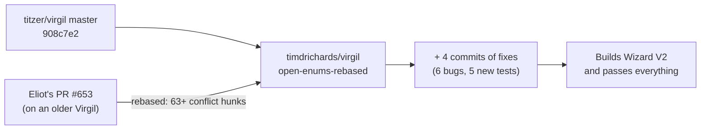

- **Eliot's PR, rebased.** [titzer/virgil#653](https://github.com/titzer/virgil/pull/653) was written against an older Virgil. We rebased it onto upstream [`908c7e2`](https://github.com/titzer/virgil/commit/908c7e2149d94b963a093f2cb57922d34d50c46e), resolving more than 63 conflict hunks, as commit [`d9630680`](https://github.com/timdrichards/virgil/commit/d9630680007ebccfbc4c1cd71dcc3e507d10de55), with Eliot as its author. It is 1,959 lines added and 425 removed in the compiler source (`aeneas/src`).
- **Four tests dropped.** `test/open_types/name0` to `name3` from the PR use a dotted variant syntax that Virgil has since removed. Rewritten in today's syntax, they crash *upstream* Virgil too, which is a separate bug. Removed in [`987a6df3`](https://github.com/timdrichards/virgil/commit/987a6df30f9f2b821e926bce1390b040dcda97f4).
- **Six fixes**, found by trying to build Wizard with it. 56 lines added and 19 removed, each with a test.

### The six fixes

Each one was found because Wizard Version 2 failed in some way. They are in plain words first, then where to look.

**1. A subtype's case couldn't override a method the subtype didn't redeclare.** `enum Opcode.Undo { BEGIN(...) { def interpret ... } }` overrides `interpret`, which is declared on `Opcode`, not on `Opcode.Undo`. The verifier only looked in the subtype's own member list, found nothing, and the compiler crashed. The fix walks up the parents. [`Verifier.v3` line 579](https://github.com/timdrichards/virgil/blob/349669e50314228e9fb92c71c8a275743404e951/aeneas/src/vst/Verifier.v3#L579), commit [`5255a46d`](https://github.com/timdrichards/virgil/commit/5255a46d5c32a5868c3bdf42484d845b86240f4c), test [`enum_cmethod07.v3`](https://github.com/timdrichards/virgil/blob/349669e50314228e9fb92c71c8a275743404e951/test/enums/enum_cmethod07.v3).

**2. Native code called the wrong method.** This one is sneaky. On the `v3i` interpreter, `Opcode.Undo.BEGIN.interpret(...)` ran `BEGIN`'s code. Compiled to x86-64, it ran the *default* instead. The cause: the root enum's method table is laid out from the list of its live subclasses, and a case of a subtype enum was only added to its *immediate* parent's list (`Opcode.Undo`), never to `Opcode`'s. So the root's table never got the override. The fix adds a live case to every ancestor's list. [`Reachability.v3` line 594](https://github.com/timdrichards/virgil/blob/349669e50314228e9fb92c71c8a275743404e951/aeneas/src/ir/Reachability.v3#L594), same commit, test [`enum_cmethod08.v3`](https://github.com/timdrichards/virgil/blob/349669e50314228e9fb92c71c8a275743404e951/test/enums/enum_cmethod08.v3).

**3. A field named `shortName` clashed with a built-in.** The PR gives every enum a synthesized `shortName` member. Wizard already has an enum with its own `shortName` field (the debugger's `DbgCommand2`), and the two collided. The fix keeps the declared field. [`Vst.v3` line 308](https://github.com/timdrichards/virgil/blob/349669e50314228e9fb92c71c8a275743404e951/aeneas/src/vst/Vst.v3#L308) and [`MethodEnv.v3` line 404](https://github.com/timdrichards/virgil/blob/349669e50314228e9fb92c71c8a275743404e951/aeneas/src/vst/MethodEnv.v3#L404), commit [`fa252b5e`](https://github.com/timdrichards/virgil/commit/fa252b5eb79227bc84fc4f0a10a52920bedf8a19), test [`enum_shortname01.v3`](https://github.com/timdrichards/virgil/blob/349669e50314228e9fb92c71c8a275743404e951/test/enums/enum_shortname01.v3).

**4. `Opcode.count` and `for (op in Opcode)` ignored subtype cases.** They covered only the root's own cases, so Wizard's placement loop never saw an extension. The fix makes both cover the whole range of tags, from the root's first to the last subtype's last. [`MethodEnv.v3` line 350](https://github.com/timdrichards/virgil/blob/349669e50314228e9fb92c71c8a275743404e951/aeneas/src/vst/MethodEnv.v3#L350) and [`VstSsaGen.v3` line 346](https://github.com/timdrichards/virgil/blob/349669e50314228e9fb92c71c8a275743404e951/aeneas/src/ssa/VstSsaGen.v3#L346), commit [`a961f28a`](https://github.com/timdrichards/virgil/commit/a961f28a08a58fd9675f37559f47d178e474aad5), test [`enum_hier_iter01.v3`](https://github.com/timdrichards/virgil/blob/349669e50314228e9fb92c71c8a275743404e951/test/enums/enum_hier_iter01.v3).

**5. Cases you could only reach by looping were treated as dead.** Virgil throws away code it can't reach, and it decides a case is live when it sees that case used as a constant. A case that only ever comes out of `for (op in Opcode)` was never named, so its method table slot was left empty, and calling a method on it in native code jumped to nothing. The fix marks every case in the loop's range as live. Same place and commit as fix 4.

**6. Initialization order (the one Ben warned about).** This is the most interesting one, so here's a picture.

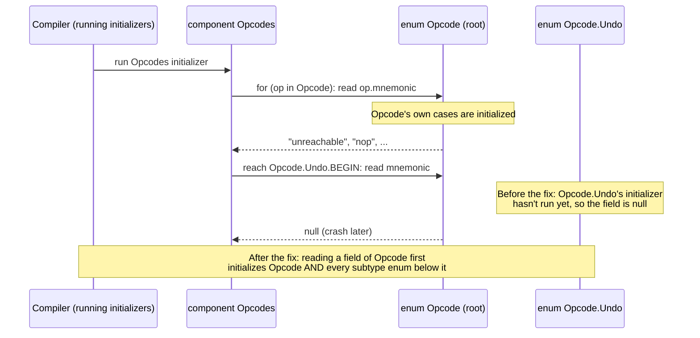

In plain words: the values of a case's fields (`prefix`, `code`, `mnemonic`, ...) are filled in by the initializer of *the enum that declares the case*. `Opcode.Undo`'s cases get theirs from `Opcode.Undo`'s initializer. Virgil runs an enum's initializer the first time something reads one of its fields. But `Opcodes` read the field through the root type `Opcode`, which triggered only `Opcode`'s initializer. The extension cases' fields were still null. The fix: reading a field through an enum type initializes that enum *and its whole hierarchy below it* first ([`initEnumHierarchy`](https://github.com/timdrichards/virgil/blob/349669e50314228e9fb92c71c8a275743404e951/aeneas/src/ssa/SsaBuilder.v3#L778), called at [line 125](https://github.com/timdrichards/virgil/blob/349669e50314228e9fb92c71c8a275743404e951/aeneas/src/ssa/SsaBuilder.v3#L125)), commit [`349669e5`](https://github.com/timdrichards/virgil/commit/349669e50314228e9fb92c71c8a275743404e951), test [`enum_init_order01.v3`](https://github.com/timdrichards/virgil/blob/349669e50314228e9fb92c71c8a275743404e951/test/enums/enum_init_order01.v3).

Ben's worry about extensible enums was exactly this: who initializes what, when. It turned out to be real, and fixable, but it's a language design decision, not just a bug fix. "Initialize the whole hierarchy on any field read" is *one* answer. Ben may want a different one.

### Did the fixes break anything?

- Virgil's `enums` test suite: 310 of 310 pass on `v3i`, x86-64-linux and the JVM.
- `core`, `variants`, `cast`, `open_types`, `fsi32`, `fsi64`, `float`, `layout`, `funexpr` and `stacktrace` give the same results as upstream.
- Unmodified Wizard master, built with this compiler, passes exactly the same tests as when built with upstream Virgil.
- The compiler binary grows about 2.4% (x86-64) and 1.2% (jar). Bootstrapping speed is the same within noise.

---

## 17. Gotchas when writing a Version 2 extension

Things that will bite you, so you can see them coming:

- **Subtype enum names are global.** `enum Opcode.Counter` also declares a type called `Counter`, visible everywhere. When we wrote a test extension with a helper class named `Counter`, they collided. We renamed the enum `Opcode.Count`. Pick enum names nobody else uses.
- **The core can't `match` on your cases.** Every core `match` reaches extension cases through its `_` arm, which calls a hook. If you need a tier to treat your instruction specially, you need a hook for it, not a new `match` arm.
- **Loops over every opcode see your cases, and the placeholder.** Any core code that walks `Opcode` and indexes by `op.code` must skip `Opcodes.isExt(op)`. In a build *without* extensions, the only such case is `_`, whose fields are all null. We found this when `Opcodes.findByName` crashed on a null mnemonic.
- **A floating case's declared code is a lie.** Its real byte is `Opcodes.codeOf(op)`.
- **You need the patched compiler.** #653 as submitted doesn't initialize subtype enums before the core reads them, and every extension case then reads as null.

---

## 18. Building and testing it yourself

First build the patched compiler from [`timdrichards/virgil` branch `open-enums-rebased`](https://github.com/timdrichards/virgil/tree/open-enums-rebased) and put its `bin` on your path. Then, from a checkout of `ext-v2`:

```bash
./build.sh --ext=undo,ministe wizeng x86-64-linux
```

```bash
./build.sh --ext=undo,ministe unittest x86-64-linux
```

```bash
bin/unittest.x86-64-linux undo ministe extopcode
```

For smaller binaries with both extensions, add Eliot's method-table compaction (see [chapter 19](#19-how-it-measures-up)):

```bash
V3C_OPTS=-compact-mtable=4 ./build.sh --ext=undo,ministe wizeng x86-64-linux
```

We ran everything in an x86-64 Linux container on an Apple silicon Mac (Rosetta). The full Wizard suites, with spec tests pinned to one spec commit, give the same results as master on `x86-64-linux` and `v3i`, apart from the 6 new `extopcode` tests.

---

## 19. How it measures up

Full numbers are in the [comparison](ExtensionsV1V2.md). Side by side:

| | Version 1 | Version 2 |
|---|---|---|
| Core Wizard lines | +558 / −29, 16 files | +450 / −29, 14 files |
| `undo` / `ministe` | 138 / 225 lines | 125 / 204 lines |
| Virgil compiler lines | none | +2,015 / −444 (#653 plus fixes) |
| `wizeng` x86-64, no extensions | +0.36% | +0.25% |
| `wizeng` x86-64, both extensions | +1.44% | +2.41% (+1.20% with `-compact-mtable=4`) |
| Add an instruction | +11 / −1, 3 places | +9, 2 places |
| Add an extension (2 instructions) | 41 lines, 2 files | 36 lines, 1 file |
| Forget to register an instruction | compiles; fails at validation | impossible |
| Speed of a short transaction | about 15 to 24 µs | the same |

**Why is Version 2 bigger with extensions?** Remember the method tables from [chapter 4](#4-open-enums-in-five-minutes): `Opcode` has eight hooks, and each gets a table with a slot for every one of about 595 opcodes. That's thousands of slots, almost all pointing at the same default. `-compact-mtable` notices this and halves the overhead (any threshold from 4 to 100 gives the same size), and all extension tests pass with it. *Without* extensions, Version 2 is smaller than Version 1 on every target.

**Speed.** With the jit, all builds run the same. The fast interpreter's timings swing by up to ±20% between builds in no consistent direction (even master built by the two compilers differs by up to 15%), which looks like code layout, magnified by Rosetta. These numbers need repeating on native x86-64. For extension instructions themselves, V1 and V2 are the same: the time goes into starting a transaction (page protection, the shadow buffer, a page copy), not into dispatching the instruction.

---

## 20. Is it right? A checklist for reviewers

**Things we tested and are confident about**

- Every tier runs every extension instruction; functions using them stay in the interpreter while callees compile.
- A build without `--ext` behaves exactly like master. The `_` placeholder never reaches a table.
- Rollback is byte-exact for mixed-width, unaligned, bulk, cross-page and compiled-callee writes.
- The compiler fixes each have a test, and the compiler passes Virgil's own suites as listed in chapter 16.

**Known limits (by design, for now)**

- **No fast path.** Extension instructions always go through `runtime_EXT` in fast-int and keep their function out of the compiler. Per-target hooks (`emitFastInt`) aren't built, because `Opcode` must compile for `v3i`, which doesn't include the x86-64 code.
- **Branch-out checks cover `br`, `br_if`, `br_table` and `return` only,** not `br_on_*`, `return_call*`, `throw` or `delegate`.
- **Memory tracking gaps:** `memory.grow` during tracking, memories that aren't a multiple of 4 KiB, and host functions that write guest memory without `write_range_*`.

**Things worth a second look (found while writing this guide)**

These apply equally to Version 1, since the shared code is identical.

1. **A trap inside a `tblock` that isn't `tfail` seems to leave the transaction open.** We have not tested this; it comes from reading the code. If code inside a `tblock` traps, Wizard unwinds without reaching `TEND`, so [`TxnLog`](https://github.com/timdrichards/wizard-engine/blob/2c8f1798cc02b8e8cab5eb2a5156227173026f5d/src/ext/ministe/MiniSte.v3#L135) keeps its marks and memory stays under tracking. The next `tblock` would nest inside a ghost. Real STE aborts on a trap.
2. **Plain stores are transactional too.** Tracking watches all of memory 0, so a plain `i32.store` inside a `tblock` is undone by `tfail`, same as `i32.tstore`.
3. **Plain `global.set` is *not* transactional.** Only `tglobal.set` saves the old value. Memory and globals behave differently.
4. **The shadow buffer is the size of the whole memory,** allocated each time the outermost transaction begins ([`startTracking`](https://github.com/timdrichards/wizard-engine/blob/2c8f1798cc02b8e8cab5eb2a5156227173026f5d/src/engine/native/NativeMemory.v3#L127)). Fine for a 64 KiB test memory; a 1 GiB memory would allocate 1 GiB per transaction. A pool of page buffers would scale.
5. **Collision errors are mute on native builds.** The build stops, but you see `ExceptionInInitialization: !NotFoldable`, not the message. `v3i` prints the real one.
6. **The `isExt` test relies on core cases coming first.** `isExt(op)` is `op.tag > Opcode.SWITCH.tag`. If someone adds a core opcode after `SWITCH` without updating `LAST_CORE_TAG`, it would be treated as an extension. A comment says so, but a test that checks `LAST_CORE_TAG` is the last core case would be cheap insurance.

**Things found in Wizard and Virgil, along the way**

- `OpcodePage`'s `[code]` operator reads the top-level page even for a code on a subpage. Nothing in the core uses it that way.
- Two spec tests pulled on 2026-10-27 (`memory64/table_grow64`, `exceptions/cast`) fail on unmodified master.
- Upstream Virgil crashes in `MethodEnv.lookupVariantCaseMember` on the rewritten `open_types/name0-3` tests. Unrelated to open enums; worth its own report.

---

## 21. Glossary

**Block / `end`.** Wasm's structured control flow. `block ... end` groups instructions; `br n` jumps to the end of the n-th enclosing block.

**Case.** One value of an enum, like `Opcode.I32_ADD` or `Opcode.Undo.BEGIN`.

**Component.** A Virgil singleton. Its initializer runs at compile time.

**Dispatch table.** The fast interpreter's array from opcode to machine-code handler.

**`ExtFrame`.** What an `interpret` hook sees of the running program.

**Fixed / floating.** An extension instruction either sits exactly where it asks, or takes any free single byte (`isFloating()`).

**Immediate.** Bytes baked into an instruction after its opcode.

**Instance.** A loaded, running Wasm module with its own memory and globals.

**Method table (mtable).** For per-case methods: an array indexed by case tag, holding which code to run.

**Open enum.** An enum ending in `_`, which other files can extend with subtype enums.

**Opcode / prefix.** Which instruction this is. A prefix byte means "the opcode number follows".

**Page (two meanings!).** An `OpcodePage` is the opcode table for one prefix. An OS page is a 4 KiB chunk of memory the operating system can protect.

**Per-case method.** A method an enum declares and each case may override.

**Placeholder (`_`).** The case that marks an enum as open. In a build without extensions, it's the only case past `SWITCH`.

**SPC.** Wizard's single-pass compiler to x86-64.

**STE.** The Wasm Simple Transactions proposal.

**Subtype enum.** `enum Opcode.Undo { ... }`: an enum whose cases are also cases of `Opcode`.

**Tag.** A case's number. Core cases first, then subtypes.

**Tier.** One way of running code: v3-int, fast-int or SPC.

**Trap.** A Wasm runtime error that stops execution.

**Validation.** Checking that code is well-typed before running it.

**Virgil / Aeneas.** The language Wizard is written in, and its compiler.

**Visitor.** An object with one method per instruction, called while walking code.

**Write observer.** An object told before memory is written, so it can save the old bytes.

---

*That's the tour. You now know how to add an instruction to Wizard by writing one enum case, and exactly how much of the Virgil compiler had to be convinced first. Go forth and extend.*
